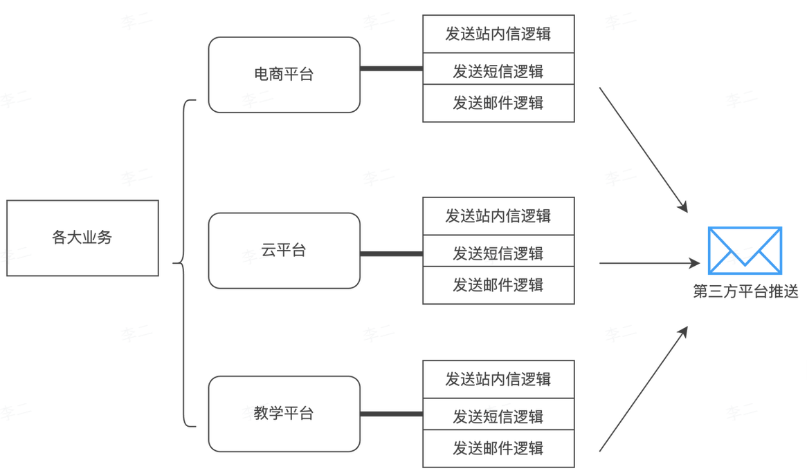

## 1  什么是消息推送系统？

消息推送系统是专门为统一管理和高效分发消息而设计的基础设施。

## 2  典型应用场景

- 电商的促销推送
- 金融通知
- 社交互动：消息提醒、好友请求等
- 系统运维：
- 用户唤醒：优惠活动对老玩家进行推送

## 3  推送系统的作用

### 3.1  传统消息处理模式

消息推送的实现具有多种方式，比如通过第三方平台，或是直接内嵌在业务中，他们往往存在以下问题：

1. 企业往往需要多种渠道向用户发送消息，对于每种渠道都需要有对应的接口以及管理
2. 不同推送渠道存在消息丢失、投递失败等问题，影响用户体验
3. 当业务量大时，直接通过业务发送消息，可能导致系统拥堵甚至宕机
4. 如果每个业务线都独立开发和维护推送系统，成本高容易重复造轮子
5. 面对复杂场景，比如延迟推送、基于规则触发的推送等，需要重复开发和部署

### 3.2  消息推送系统

消息推送系统，作为专门统一管理和分发消息而设计的基础设施，具有以下优势：

1. 统一对接各种消息渠道，为业务提供一致的接口，降低系统的复杂度
2. 推送平台提供多种保障机制，如重试策略，优先级策略、实时状态回调、失败后自动切换备用渠道等
3. 推送平台通过异步队列、分批发送和流量控制等技术，保障高并发下场景的平稳运行
4. 推送平台作为通用服务，统一封装核心能力，为业务方提供即插即用的推送能力，大幅度降低开发和运维成本
5. 内置高级能力，比如延迟推送、定时任务和多条件触发等，快速满足业务需求。

## 4  推送系统项目的优势

1. 场景宽泛，方便立意
2. 业务属性较弱，适合抽成一个独立
3. 核心逻辑聚焦，易于掌握
4. 囊括多种核心技术栈

## 5  推送系统项目的价值

1. 提升架构设计能力
2. 应对面试答辩
