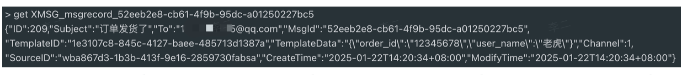
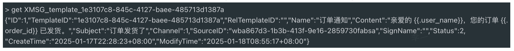
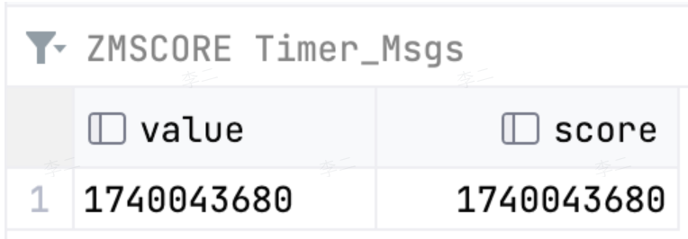

## 1  发送记录表 `t_msg_record`

表名：`t_msg_record`

作用：记录发送过的消息，方面后续查看

表结构：

| 字段              | 类型             | 说明                      |
| --------------- | -------------- | ----------------------- |
| `id`            | `bigint(20)`   | 主键自增 ID                 |
| `msg_id`        | `varchar(256)` | 消息 ID，通过 `uuid` 生成      |
| `to`            | `varchar(256)` | 消息接收者                   |
| `subject`       | `varchar(256)` | 消息主题                    |
| `source_id`     | `varchar(256)` | 业务 ID                   |
| `template_id`   | `varchar(256)` | 模板 ID，使用模板时才有意义         |
| `template_data` | `varchar(256)` | 模板传入参数                  |
| `channel`       | `int(10)`      | 消息类型。1：邮件；2: 短信；3: 飞书   |
| `status`        | `int(10)`      | 消息状态。1: 等待中；2: 成功；3: 失败 |
| `create_time`   | `datetime`     | 创建时间                    |
| `modify_time`   | `datetime`     | 修改时间                    |

## 2  全局配额表 `t_global_quota`

表名：`t_global_quota`

作用：用于业务渠道的默认配额设置（面向普通用户）

表结构：

| 字段            | 类型           | 说明                                              |
| ------------- | ------------ | ----------------------------------------------- |
| `id`          | `bigint(20)` | 主键自增 ID                                         |
| `channel`     | `int(10)`    | 消息类型。1: 邮件；2: 短信；3: 飞书                          |
| `num`         | `int(10)`    | 限频数，单位：s                                        |
| `unit`        | `int(10)`    | 限频单位，单位：ms。支持 2 个选项： 1000——1s 60000——1min |
| `create_time` | `datetime`   | 创建时间                                            |
| `modify_time` | `datetime`   | 修改时间                                            |

## 3  渠道配额表 `t_source_quota`

表名：`t_source_quota`

作用：记录某个业务可发送消息的频率。如果业务渠道同时配置了全局配额表和业务配额表，那么以业务配额表为准。

表结构：

| 字段            | 类型             | 说明                                              |
| ------------- | -------------- | ----------------------------------------------- |
| `id`          | `bigint(20)`   | 主键自增 ID                                         |
| `source_id`   | `varchar(256)` | 业务 ID                                           |
| `channel`     | `int(10)`      | 消息类型。1: 邮件；2: 短信；3: 飞书                          |
| `num`         | `int(10)`      | 限频数，单位：s                                        |
| `unit`        | `int(10)`      | 限频单位，单位：ms。支持 2 个选项： 1000——1s 60000——1min |
| `create_time` | `datetime`     | 创建时间                                            |
| `modify_time` | `datetime`     | 修改时间                                            |

## 4  消息模板表 `t_msg_template`

表名：`t_msg_template`

作用：记录用户设置的模板，发起消息时，通过模板 ID 就可以使用该模板

表结构

| 字段                | 类型              | 描述                      |
| ----------------- | --------------- | ----------------------- |
| `id`              | `bigint`        | 模板唯一标识                  |
| `template_id`     | `varchar(256)`  | 模板 ID                   |
| `rel_template_id` | `varchar(256)`  | 关联模板 ID，该字段用于支持第三方平台模板。 |
| `name`            | `varchar(256)`  | 模板名称                    |
| `content`         | `varchar(4096)` | 模板内容，支持占位符              |
| `source_id`       | `varchar(256)`  | 业务 ID                   |
| `sign_name`       | `varchar(50)`   | 签名，短信渠道需要               |
| `subject`         | `varchar(256)`  | 消息主题                    |
| `channel`         | `int(10)`       | 消息类型。1：邮件；2: 短信；3: 飞书   |
| `status`          | `tinyint(3)`    | 消息状态                    |
| `ext`             | `varchar(256)`  | 扩展字段，保留                 |
| `create_time`     | `datetime`      | 创建时间                    |
| `modify_time`     | `datetime`      | 修改时间                    |

- 部分厂商的短信渠道需要 `sign_name`

## 5  中转站列表（MySQL 中转站） `t_msg_queue`

| 字段              | 类型             | 说明                             |
| --------------- | -------------- | ------------------------------ |
| `id`            | `bigint(20)`   | 主键自增 ID                        |
| `msg_id`        | `varchar(256)` | 消息 ID，通过 `uuid` 生成             |
| `to`            | `varchar(256)` | 消息接收者                          |
| `subject`       | `varchar(256)` | 消息主题                           |
| `source_id`     | `varchar(256)` | 业务 ID                          |
| `template_id`   | `varchar(256)` | 模板 ID，使用模板时才有意义                |
| `template_data` | `varchar(256)` | 模板传入参数                         |
| `channel`       | `int(10)`      | 消息类型。1：邮件；2: 短信；3: 飞书          |
| `status`        | `int(10)`      | 消息状态。1: 等待中；2: 处理中；3: 成功；4: 失败 |
| `priority`      | `int(20)`      | 优先级。1：低优先级；2: 中优先级；3: 高优先级     |
| `create_time`   | `datetime`     | 创建时间                           |
| `modify_time`   | `datetime`     | 修改时间                           |

## 6  定时消息队列表（MySQL 中转站）`t_msg_tmp_queue_timer`

| 字段               | 类型              | 说明                             |
| ---------------- | --------------- | ------------------------------ |
| `id`             | `bigint(20)`    | 主键自增 ID                        |
| `msg_id`         | `varchar(256)`  | 消息 ID，通过 `uuid` 生成             |
| `req`            | `varchar(4096)` | 发送消息请求的序列化串                    |
| `send_timestamp` | `bigint(10)`    | 发送时间戳，指定消息发送的时间                |
| `status`         | `int(10)`       | 消息状态。1: 等待中；2: 处理中；3: 成功；4: 失败 |
| `create_time`    | `datetime`      | 创建时间                           |
| `modify_time`    | `datetime`      | 修改时间                           |

## 7  Redis 表格

### 7.1  推送记录

- Key：`前缀_MSGID`
- Value：推送记录的 Json 序列化字符串

### 7.2  模板缓存

- Key：`前缀_templateID`
- Value：模板信息的 Json 序列化字符串

### 7.3  配额缓存

- Key：`额度配置前缀_sourceID_channel`
- Value：`limit_div` 字符串
	- `limit`：额度数量
	- `div`：单位粒度

### 7.4  限频计数器  

- Key：`rate_limit:{sourceID}:channel:{时间戳}`
- Value：计数

### 7.5  定时消息时间点存储

- Key：`Timer_Msgs`
- Value：触发时间戳（秒级）
- Score：触发时间戳（秒级）

