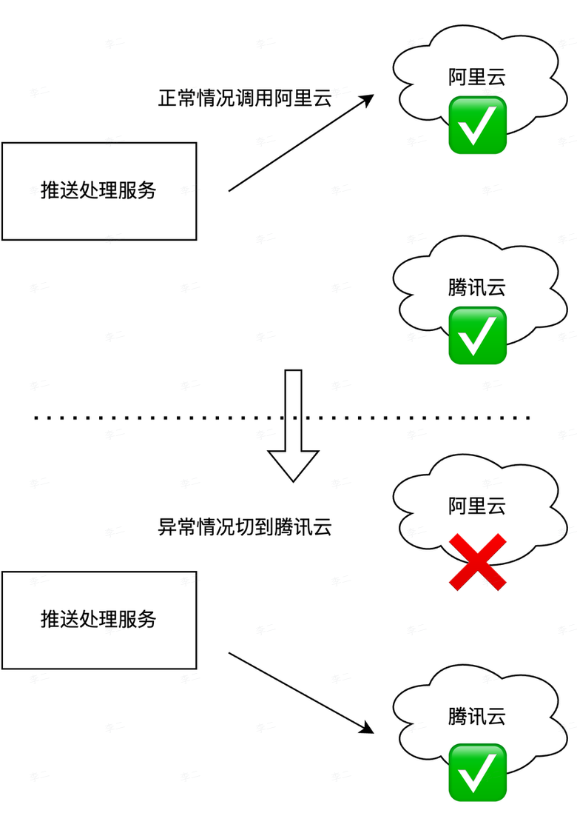

## 1  异常情况：第三方推送挂掉

解决思路：多厂商容灾

准备多个第三方平台，主要使用其中一家，其他家购买少量额度。这样当一个第三方挂掉时，就可以切换到其他的厂商。

## 2  异常情况：恶意用户大量请求

解决思路：额度限制 + 黑名单

- 通过额度控制防止单用户过大压力搞崩系统，或单用户占用过多资源，详细见 [5特性：额度限制](5特性：额度限制.md)
- 对于明确的恶意用户，通过黑名单机制来限制。
	- 对于黑名单用户，在限额表中，将字段 `num` 设为 `-1`

## 3  异常情况：业务服务挂掉

- 本系统的业务都是无状态的多机部署
- 如果接入了 `k8s` 或系统部署在云上，一个 POD 挂掉会自动提出并自动重启

## 4  异常情况：MySQL 挂掉

应对思路：主从部署模式

- 当某一个节点挂掉时，从节点代替它继续服务。
- 对于有数据的服务，需要在主从节点之间设置数据同步方案，以防数据丢失
- 主从模式下可以实现读写分离。主节点聚焦写处理。对于实时性要求不强的读处理，则分流到从节点。

## 5  异常情况：Redis 挂掉

应对思路：主从模式 + 哨兵模式

- 哨兵模式将提供主从节点的自动化切换能力。
