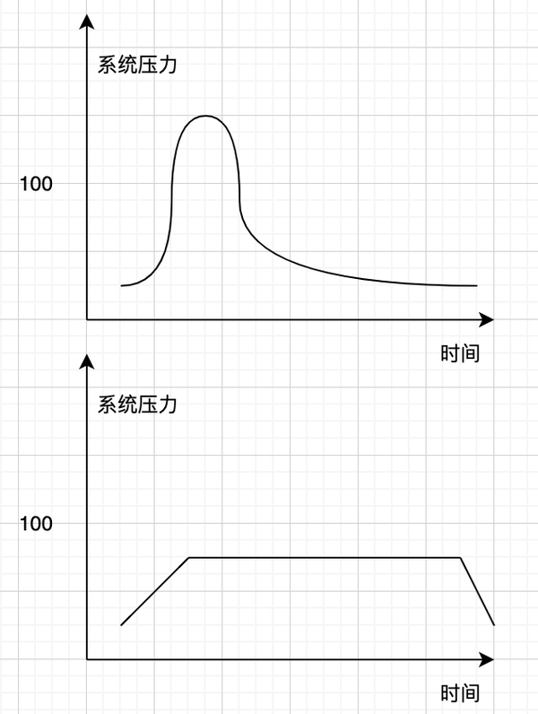

## 1  消息队列是什么？

消息队列是用于传递消息的队列，有先入先出的、可靠、高性能的特点。

消息队列是分布式系统不可缺少的中间件，一般用于异步流程、消息分发、流量削峰等问题。

市场上常用的消息队列有 ActiveMQ、RabbitMQ、ZeroMQ、Kafka、MetaMQ、RocketMQ 等

## 2  为什么消息推送系统要接入消息队列？

消息队列在消息推送系统中主要承担**消息中转站**的角色。

对于消息推送系统，消息队列的作用主要是

1. 方便重试。当消息发送失败时，通过消息中转站能更方便地实现异步重试，进而提高消息推送的成功率。——异步流程。
2. 实现流量管控。第三方平台往往有频率的限制，通过消息队列做中转站，能够按下游承载能力进行发送频率的调节。尤其是面对突来的流量时，可以做流量削峰。——流量削峰。
3. 更好协调资源。通过消息中转站，可以更好协调资源，比如实现消息的优先级功能，使更重要的消息或更重要的客户优先享受服务。

## 3  消息队列的应用场景

### 3.1  异步流程

当一个接口的处理时间很长，且不能通过水平扩容来解决，就需要**异步**。

不能通过水平扩容来解决的情况：

1. 视频下载。受限于网络带宽等因素，扩容无用
2. 区块链等共识场景。只有单机能够出块，扩容无用
3. 长业务流程。当一个业务需要经过多个微服务时，也许每个微服务的时间都很短，但是由于数量多，整体时间是无法接受的。

面对上述情况，用户不能通过同步接口长时间等待结果，那么就应该将其做成异步——先扔进消息队列，后续再进行消费。

### 3.2  消息分发

假设一个核心服务 A，其将传递消息给多个下游服务 B、C 等。如果是直接将消息发送给这些服务，当增加新的下游服务时，就需要修改代码。

如果通过消息队列做中转站，就能对业务解耦，实现功能的复用。

### 3.3  流量削峰

流量消峰，就是对突发流量进行均匀化处理，以防止瞬时流量打崩下游组件或服务。

在架构上，流量削峰和异步流程是相同的架构：都是将请求先存入消息队列内，之后在逐渐消费。

但二者的不同之处在于：

- 异步流程面对的是单个请求的处理时间过长的问题
- 流量削峰面对的是突发流量问题

## 4  消息队列选择思路

市场上常用的 MQ 中，ZeroMQ 是轻量级的，一般用于学习，而不会用到生产中。

四种最热门的产品 ActiveMQ、RabbitMQ、RocketMQ、Kafka 的比较如下表：

| 特性    | ActiveMQ | RabbitMQ | RocketMQ  | Kafka        |
| ----- | -------- | -------- | --------- | ------------ |
| 单机吞吐量 | 万级       | 万级       | 10 万级     | 10 万级        |
| 时效性   | 毫秒级      | 微秒级      | 毫秒级       | 毫秒级          |
| 可用性   | 高（主从）    | 高（主从）    | 非常高（分布式）  | 非常高（分布式）     |
| 消息重复  | 至少一次     | 至少一次     | 至少一次/至多一次 | 至少一次/至多一次    |
| 消息顺序性 | 有序       | 有序       | 有序        | 分区有序         |
| 支持主题数 | 千级       | 百万级      | 千级        | 百级（多了性能下滑严重） |
| 消息回溯  | 不支持      | 不支持      | 支持（按时间）   | 支持（按 offset） |
| 管理界面  | 普通       | 普通       | 完善        | 普通           |

选型时，需要根据业务类型，结合产品特性来选择：

- 面对天猫双十一类超大型的秒杀活动，优先考虑吞吐量。因此，可以选择 `RocketMQ`、`Kafka` 这种高吞吐的
- 面对公司中台类，需要对外提供能力类的服务，优先考虑支持主题数。因此，可以根据情况选择千级的 `ActiveMQ`、`RocketMQ`，甚至是百万级的 `RabbitMQ`。
- 面对金融类业务，优先考虑稳定性、安全性。因此，可以考虑分布式部署的 `Kafka` 和 `RocketMQ`

## 5  消息推送系统中用哪个消息队列？

引入消息队列后，消息推送上下游结构如下图

- 性能上，RocketMQ、Kafka 达到 10 万级，相对于其他万级的消息队列会更强一些。
- 可靠性上，RocketMQ、Kafka 都是分布式部署。（消息推送中台还是需要一些可靠性的）
- 主题数目上，RocketMQ 具备千级的主题数量，而 Kafka 也具备百级的主题数量，在消息推送场景都能满足需求

最后选择了 Kafka，因为团队的技术栈主要是 Kafka 的。
