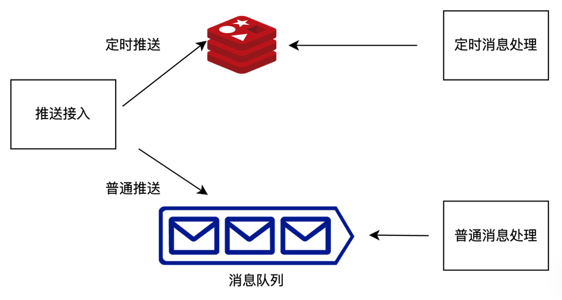
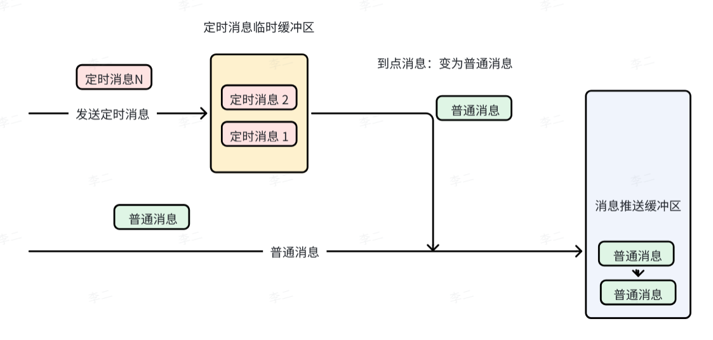

## 1  为什么需要定时推送功能？

在某些业务场景中，消息必须在**指定时间**才能发送（如活动提醒、预约通知等）。因此，系统需要具备**定时推送**能力，即在预设时间点将消息从暂存区取出并执行发送。

## 2  如何实现？

通过 Redis 来实现定时推送能力



## 3  整体设计思路

1. 定时临时缓冲区：所有的定时消息都先暂存在临时缓冲区，并不立即进入推送流程。
2. 到期转换：当定时消息的预订时间到达时，将其从缓冲区中取出，转换为一条普通消息，然后与普通消息一样进入后续的发送队列。


## 4  方案一：主动轮询 MySQL

### 4.1  步骤

1. 注册定时消息。在 MySQL 中，在定时消息列表中存储的每条定时消息。
2. 周期性轮询。每隔一个微小的时间，对 MySQL 中的定时任务列表进行全量查询。
3. 条件过滤并执行。查询条件为 `执行时间<=当前时间 AND 状态 = '待执行'`，将结果取出后执行业务逻辑，并更新状态。

### 4.2  优化：添加索引

为 `执行时间戳` 字段建立 **B+ 树索引**，使得按时间范围查询的时间复杂度从 O(N) 降至 **O(logN)**，加速过滤。

### 4.3  潜在问题

| 问题         | 说明                                                     |
| ---------- | ------------------------------------------------------ |
| **数据库压力**  | 为降低时间误差，需缩短轮询间隔（如 100ms），但高频率查询 MySQL 会增大数据库负载，影响其他业务。 |
| **无效扫描浪费** | 定时任务通常集中在某些时间点，大部分轮询可能没有命中任务，造成资源空耗。                   |

### 4.4  定时消息队列表 `t_msg_tmp_queue_timer`

| 字段               | 类型              | 说明                             |
| ---------------- | --------------- | ------------------------------ |
| `id`             | `bigint(20)`    | 主键自增 ID                        |
| `msg_id`         | `varchar(256)`  | 消息 ID，通过 `uuid` 生成             |
| `req`            | `varchar(4096)` | 发送消息请求的序列化串                    |
| `send_timestamp` | `bigint(10)`    | 发送时间戳，指定消息发送的时间                |
| `status`         | `int(10)`       | 消息状态。1: 等待中；2: 处理中；3: 成功；4: 失败 |
| `create_time`    | `datetime`      | 创建时间                           |
| `modify_time`    | `datetime`      | 修改时间                           |

## 5  方案二：Redis + MySQL 组合方案（推荐）

### 5.1  设计目标

- 利用 **Redis 的高 QPS（可达 10w+）** 来支撑高频扫描，避免对 MySQL 造成压力。
- 利用 **MySQL 的大容量存储** 保存完整消息内容，避免 Redis 内存资源被大量占用。

### 5.2  Redis 存储设计

使用 Redis 的 **有序集合（ZSet）** 来存储定时任务的 " 索引 "，结构如下：

- `key`：`id`，消息唯一 id，是 MySQL 自增 ID
- `value`: 任务的**执行时间戳**
- `score`：任务的**执行时间戳**

### 5.3  步骤

#### 5.3.1  添加定时任务

1. 向 MySQL 插入一条完整的任务记录
2. 同时执行 `ZADD` 命令，将定时消息更新到 Redis 中

#### 5.3.2  Redis 高频扫描查询

1. 启动一个扫描进程，每隔 `100ms` 执行一次 Lua 脚本
2. Lua 脚本中执行的操作如下
	1. 使用 `ZRANGEBYSCORE` 获取范围内的消息 ID
	2. 使用 `ZREM` 删除这些消息
	3. 返回所有到期的任务 ID 列表

```SQL
const LUA_ZRANGEBYSCORE_AND_REM = `

-- 定义 ZSet 的键名
local key = KEYS[1]
local minScore = ARGV[1] -- 获取第一个参数 最小值
local maxScore = ARGV[2] -- 获取第二个参数 最大值

-- 查询 [minScore, maxScore] 范围内的元素
local elements = redis.call('ZRANGEBYSCORE', key, minScore, maxScore)

-- 遍历并删除这些元素
for i, elem in ipairs(elements) do
    redis.call('ZREM', key, elem)
end

-- 返回删除的元素列表
return elements
`;
```

#### 5.3.3  MySQL 查询到点消息列表

- 根据上一步返回的任务 ID 列表（或直接按时间范围查询），从 MySQL 中获取任务详情，并确保状态仍为 " 待执行 "，避免重复处理。

#### 5.3.4  转换为普通消息并投递

- 将获取到的任务内容封装成普通消息请求，**投递到普通消息队列**（如 RabbitMQ、Kafka 或内存队列），由下游消费者进行实际推送。
- 更新 MySQL 中任务状态为 " 已处理 "。

### 5.4  主从部署

与 [3消息中转站：MySQL](3消息中转站：MySQL.md) 一样，定时消息的消费者采用主从部署模式。

- **主节点（Leader）**：实际执行业务逻辑的节点，负责轮询 Redis、查询 MySQL 并投递消息。
- **从节点（Follower/Standby）**：高可用热备节点，不处理业务，仅持续监控主节点健康状态，随时准备接管。

**选举流程**基于 **分布式锁**（例如 Redis 的 `SET NX EX` 或 Redisson）实现：

1. **抢占锁**：服务启动时，所有节点尝试获取同一把分布式锁。
2. **胜者为王**：成功获取锁的节点立即成为主节点，并开始执行定时扫描任务；其余节点成为从节点，进入 " 待命 " 状态。
	1. 主节点通过不断给分布式锁续期的方式来保留自己的主节点身份。
	2. 从节点通过周期性竞争分布式锁的方式来成为主节点。当主节点长时间没有续期，导致分布式锁到点自动解锁后，从节点才可能成为主节点。

### 5.5  优势分析

| 优势          | 说明                                            |
| ----------- | --------------------------------------------- |
| **高性能扫描**   | Redis 单机可支撑十万级 QPS，100ms 扫描完全无压力。             |
| **精准命中**    | ZSet 按时间有序存储，只扫描到期的任务，避免无效查询。                 |
| **资源节约**    | MySQL 仅在确实有任务到期时才被查询，大大降低负载。                  |
| **原子性与高可用** | Lua 脚本保证获取 + 删除的原子性，即使多个扫描实例同时运行，也不会重复处理同一任务。 |
