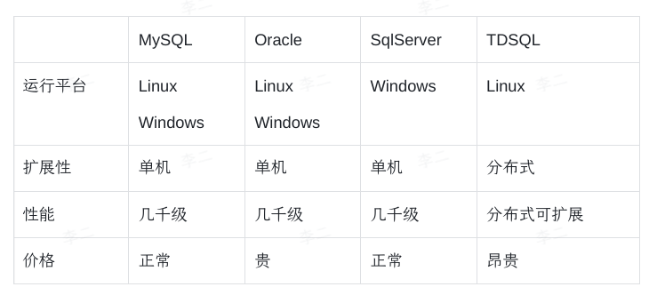

## 1  关系型数据库

常见的关系型数据库有：MySQL、Oracle、SQLServer、TDSQL 等。

优点

- 可靠性强。
- 结构规范清晰。
- 支持事务。

缺点

- 性能普遍不高。
- 表结构扩展非常不便

## 2  以键值对形式存储的非关系型数据库

常见的以键值对形式存储的非关系型数据库有：Redis、Memcache

优点

- 快速：基于内存存储，KV 结构

缺点

- 可靠性不高，可能会丢失数据

## 3  关系型数据库选型

- 后端服务运行在 Linux 上，因此不考虑 SQLServer
- Oracle 更多用于工业场景
- TDSQL 价格昂贵，且功能和 MySQL 类似
- 最后选择 MySQL 作为消息推送系统的底层数据库

## 4  NoSQL 选型

|      | Redis              | Memcache                 |
| ---- | ------------------ | ------------------------ |
| 数据结构 | 更丰富                | 支持最简单的字符串结构              |
| 持久化  | 支持                 | 不支持                      |
| 性能   | 优秀                 | 优秀（value 数据较大时，优于 Redis） |
| 市场   | 基本所有的后端团队都选择了 Redis |                          |

- 由于消息推送系统中的 value 相对都不太大，因此选择 Redis
