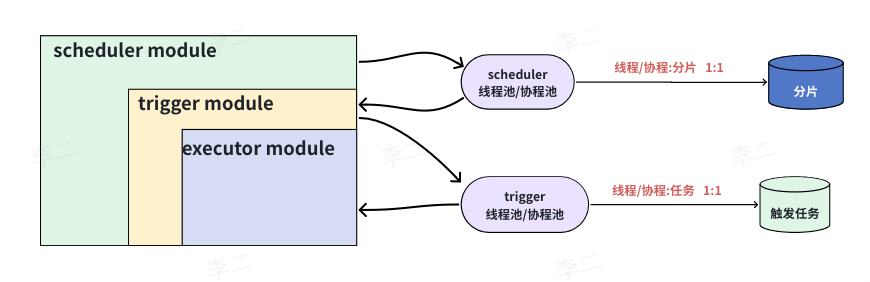

# 定时任务的调度流程

> 服务架构：3 个模块 +2 个协程池

xTimer 是一个去中心化的定时任务调度框架，根据在职责边界，将服务拆分为 3 个核心模块。模块之间存在明确的父子依赖关系，父模块通过协程池以异步方式启动子模块进行工作。

- 调度模块 (Scheduler Module)：全局统筹分配
- 触发器模块 (Trigger Module)：按时唤醒任务
- 执行模块 (Executor Module)：执行具体逻辑

# 定时任务生成流程

> 定时任务的创建与迁移，主要涉及 `webServer` 和 `migrator` 2 个模块。

- `webServer` 模块：面向用户提供的 API，用于定时器的创建与操作。
- `migrator` 模块：负责将任务在存储介质间进行迁移。

## 1  迁移逻辑的触发时机

迁移模块 (`migrator`) 的逻辑会在以下两种场景触发：

1. 用户调用激活定时器接口
2. `migrator` 定时执行迁移脚本

## 2  统一的迁移执行步骤

无论是哪种触发方式，底层的迁移执行逻辑是完全一致的：

1. 批量生成：根据定时器 `cron` 表达式，批量创建用于执行的定时任务；
2. 预加载：然后，将定时任务提前加载到 Redis 中，采用 `Redis ZSet` 进行组织，供触发器模块轮询查询。
