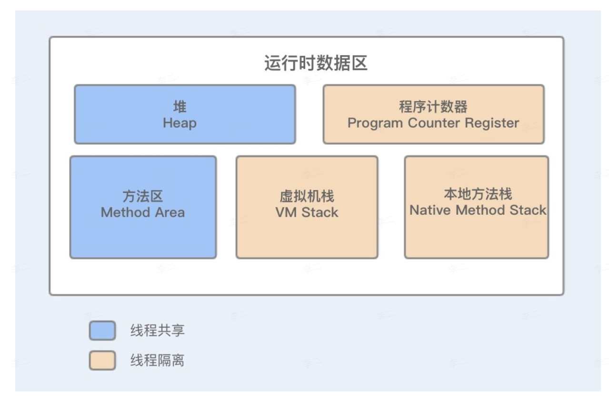

## 1  Java 内存几个区域？

### 1.1  程序计数器

- 线程私有，是当前线程的行号指示器。
- 用于记录当前虚拟机正在执行的线程的指令地址
- 主要作用有两个：
	- 当前线程所执行的字节码的行号指示器，通过它实现代码的流程控制 (顺序执行、选择、循环、异常处理)。
	- 在多线程情况下，用于记录当前线程执行位置，以便线程切换后能恢复到正确的执行位置。
- 程序计数器是唯一不会出现 `OutOfMemoryError` 的内存区域
- 生命周期和对应线程一致
	- 随着线程的创建而创建，随着线程的结束而结束

### 1.2  虚拟机栈

- Java 虚拟机栈是用于存储方法的运行信息的。
- 每个方法执行时，都会创建一个栈帧（Stack Frame），用于存储：
	- 局部变量表、操作数栈、动态链接、方法出口信息（返回地址等）。
- 方法调用对应栈帧入栈，方法返回对应栈帧出栈
- 线程私有，生命周期和其对应的线程一致
	- 随着线程创建而创建，随着线程结束而结束
- Java 虚拟机栈会出现两种错误：
	- `StackOverFlowError`
	- `OutOfMemoryError`
- 可以通过 JVM 参数 `-Xss` 设置每个线程的栈大小
	- `java -Xss2M`：指定虚拟机栈的内存大小为 2M

#### 1.2.1  局部变量表

用于存储方法参数和方法内定义的局部变量

#### 1.2.2  动态链接

- 每一个栈帧都包含一个指向**运行时常量池**中该栈帧所属方法的**符号引用**。
- 在方法调用时，会将这些符号引用转化为**直接引用**，这个过程称为动态链接（或晚期绑定）。
	- 与之对应的是静态链接（早期绑定）：符号引用在类加载节点就转化为直接引用 (如 static 方法、final 方法等)。

### 1.3  本地方法栈

- 线程私有，与虚拟机栈作用类似。
- 但，虚拟机栈为虚拟机执行 `Java` 方法服务，而本地方法栈则为虚拟机使用到的 `Native` 方法（通常为其他语言编写）服务。
- 和虚拟机栈一样，执行 Native 方法时，本地方法栈也会创建一个栈帧来存储本地方法的执行信息，包括局部变量表、操作数栈、动态连接、方法出口信息等。
- 同样可能抛出 `StackOverflowError` 和 `OutOfMemoryError`

### 1.4  Java 堆

- 线程共享，是 JVM 管理的最大的一块内存区域
- 主要用于存储对象实例（几乎所有对象都在这里分配）
- 是垃圾收集器（GC）管理的主要区域，因此常被称 "GC 堆 "
- 可细分为新生代和老年代，以支持分代垃圾回收算法
- 可以通过 JVM 参数调整大小
	- 通过 `-Xms` 设定程序启动时占用内存大小
	- 通过 `-Xmx` 设定程序运行期间最大可占用内存大小
	- `java -Xms1M -Xmx2M`
- 当堆内存不足时，就会抛出 `OutOfMemoryError`

### 1.5  方法区

- 线程共享，用于存储已经被虚拟机加载的：
	- 类信息
	- 常量池
	- 静态变量
	- 即时编译器编译后的代码缓存等
- 方法区也有垃圾回收，主要目标是**对常量池的回收**和**类的卸载**

#### 1.5.1  永久代 PermGen

- 是方法区的一种实现方式 (仅存在于 HotSpot 虚拟机，其他 JVM 无此概念)。
- 存储类信息、常量池、静态变量等，受限于 JVM 的可用内存
- 由于方法区不易扩展，因此动态生成大量类的场景（如热部署、JSP 生成等）容易造成 `OutOfMemoryError:PermGen space`

#### 1.5.2  元空间 MetaSpace

- JDK1.8 以后，永久代被彻底移除，取而代之的是元空间。
- 元空间是对方法区的一种实现，但与永久代不同的是：
	- 元空间使用本地内存（Native Memory），而不是 JVM 堆内存
	- 因此，元空间仅受到本地物理内存限制
- 通过 JVM 参数来管理初始化大小和最大值
	- `-XX:MetaspaceSize`：设置初始值
	- `-XX:MaxMetaspaceSize`：设置最大值

#### 1.5.3  运行时常量池 Runtime Constant Pool

- 是方法区的一部分，在类加载后，会将编译器生成的各种字面量和符号引用放入其中。
- 在运行期间生成的常量 (如 `String.intern()` 方法)，也会被放入其中，因此可能会引起常量池溢出。

#### 1.5.4  本地内存 Native Memory

- 元空间使用的就是本地内存，不属于 Java 堆内存。
- 其他直接内存也属于本地内存。
- 当申请的内存超过了物理内存限制，会抛出 `OutOfMemoryError`

#### 1.5.5  直接内存 Direct Memory

- 不是 JVM 运行时数据区的一部分，但被频繁使用
- 在 JDK1.4 引入的 `NIO` 类后，可以使用 `Native` 函数库直接分配堆外内存（通过 `ByteBuffer.allocateDirect`）
- 然后通过一个存储在 Java 堆中的 `DirectByteBuffer` 对象作为这块内存的引用进行操作
- 好处：避免在 Java 堆和 Native 堆之间来回拷贝数据，提高性能
- 受到物理内存限制，可能抛出 `OutOfMemoryError`

## 2  JDK1.7 和 JDK1.8 内存区域的区别

### 2.1  JDK 1.7

- 方法区基于永久代（PermGen）实现的
	- 永久代是 HotSpot 虚拟机特有概念，其他虚拟机没有该概念
- 该区域存储类的元信息、常量池、静态变量、即时编译器编译后的代码缓存
	- 在 JDK 1.7 时，已经将字符串常量池和静态变量移至 Java 堆中）
	- 也就是说，其实在 JDK 1.7 中，就已经开始了 " 去永久代 " 的进程。
	- 之所以要这么做，就是为了提高 GC 的回收效率
- 占用 JVM 堆内存，是堆的一部分
- 大小固定，必须通过 JVM 参数来设置
	- `-XX:PermSize`：设置永久代初始大小
	- `-XX:MaxPermSize`：设置永久代最大大小

#### 2.1.1  缺点和问题

- 内存大小难以确定：为永久代设置一个固定且合理的大小非常困难
- 内存溢出风险高：由于大小固定，当面对一个动态生成大量类的场景时，容易造成 `OutOfMemoryError:PermGen space`
- 性能与 GC 问题：永久代的垃圾回收条件苛刻，垃圾回收率低，且增加了 GC 的复杂性

### 2.2  JDK1.8

- JDK1.8 以来，完全移除了永久代，取而代之的是元空间 Metaspace
- 元空间是方法区的另一种实现，但内存管理机制和永久代完全不同
- 元空间中存储类的元数据、运行时常量池
	- 注意：字符串常量池和静态变量在 JDK 1.7 就已移动到 Java 堆。
- 元空间使用本地内存，不再占用 JVM 堆内存
	- 默认无上限：元空间大小仅受到本地物理内存限制
	- 可动态扩展：元空间会根据需要自动扩容，无需预先固定大小
- 通过 JVM 参数来管理初始化大小和最大值
	- `-XX:MetaspaceSize`：设置元空间初始大小（触发首次垃圾回收的阈值）
	- `-XX:MaxMetaspaceSize`：设置元空间最大大小（防止无限占用本地内存）

#### 2.2.1  优势

- 内存溢出风险降低：默认使用本地内存，空间更大，不再受到 JVM 堆内存限制
- 无需预设固定大小：自动扩容，减少了因设置不当导致的 OOM
- GC 性能提升：元空间的垃圾回收机制更高效，且减少了 Full GC 的频率
- 简化 JVM 设计：移除了永久代，降低了 JVM 内存管理的复杂性

## 3  元空间相对永久代的好处

1. 降低了内存溢出的风险。
	1. 永久代使用的是 Java 堆空间，其加载类的数量受限于 JVM 虚拟机内存大小
	2. 元空间使用的是本地内存，不再受限于 JVM 虚拟机内存大小，仅受限于本地物理内存。
	3. 相对于永久代，可使用的空间变大了很多，因此可以加载更多的类元数据。虽然仍然存在内存溢出的风险，但相对于永久代已经降低了很多
2. 无需预设固定大小。
	1. 永久代需要设置固定大小上限。想要设置一个固定且合理的大小是十分困难的事情。当设置的值不合理时，扩容十分困难，且更容易造成内存溢出
	2. 而元空间使用本地内存。当内存不足时，其将会自动扩容。仅受限于本地物理内存大小，减少了因设置不当导致的内存溢出。
3. 提升了 GC 的效率
	1. 永久代的 GC 策略十分严格，特别是对于类的卸载上，其 GC 的效率低下。
	2. 而元空间的 GC 更高效，更减少了 Full GC 的频率
4. 简化 JVM 设计
	1. 永久代是 HotSpot 虚拟机的概念，其他虚拟机并没有这种概念
	2. 永久代的实现与其他内存区域耦合较深
	3. 元空间移除了永久代，使 JVM 内存模型更加清晰统一
	4. 统一了 HotSpot 和其他 JVM 在方法区实现上的差异，简化了跨平台代码的维护

## 4  堆和栈的区别

### 4.1  存储内存

- 堆中存储的是对象实例、数组、字符串常量池 (JDK1.7+)、静态变量 (JDK1.7+)
- 栈中存储的是局部变量、操作数栈、动态连接、返回结果等

### 4.2  线程的共享性

- 堆：线程共享。所有线程都能访问堆中的对象，因此，堆中的数据需要线程安全保护（如锁或线程安全的集合）
- 栈：线程私有。每个线程都有自己独立的栈，存储该线程的方法调用状态。因此，栈中的数据不会被其他线程访问，不用考虑同步问题。

### 4.3  内存分配

- 栈
	- 使用连续内存，分配和释放通过栈指针来完成，速度非常快。 由于栈内存大小在编译时基本确定，因此分配和回收的开销非常小
	- 不需要 GC，当方法执行完毕后，栈帧自动弹出，其局部变量表、操作数栈等立即释放，内存自动回收。
- 堆
	- 内存空间大，但分配和回收相对较慢，因为需要 GC 管理，且可能产生内存碎片。堆的分配通常涉及指针碰撞或空闲列表算法
	- 由 JVM 的 GC 管理。当一个对象不再被任何对象引用时，该对象将会成为可回收对象，GC 会在合适的时机回收其占用的内存

### 4.4  生命周期

- 堆：随着 JVM 的启动而创建，随着 JVM 的关闭才销毁。堆内的对象生命周期不固定，可能长期存活，也可能短暂存活。
- 栈：每个线程启动时会创建自己的栈，当线程结束时会销毁对应的栈。栈帧的生命周期和方法调用绑定，随着方法的调用而产生，随着方法执行的完成而销毁。

### 4.5  异常情况

- 堆：当堆内存耗尽，无法为新的对象分配内存时，会抛出 `java.lang.OutOfMemoryError: Java heap space`。
- 栈：
	- 当线程请求的栈深度超过了虚拟机允许的最大深度时，抛出 `java.lang.StackOverflowError`
	- 如果栈允许动态扩展，但扩展时无法申请到足够的内存时，则抛出 `java.lang.OutOfMemoryError`

## 5  内存溢出和内存泄露的区别

- 内存溢出 (OutOfMemory)，指程序 在申请内存时，系统无法提供足够的内存空间，导致无法继续分配。
	- 本质是资源不足
- 内存泄露 (Memory Leak)，指程序在申请内存后，无法释放已经不再使用的内存空间，导致该内存被长期占用、浪费。内存泄露最终会导致内存溢出。
	- 本质是资源浪费

## 6  栈溢出的原因

在 HotSpot 中，不区分虚拟机栈和本地方法栈，二者合二为一统称为栈。因此，无法单独设置本地方法栈的大小。栈容量只能通过 `-Xss` 参数来设置。

Java 虚拟机中，栈区域可能会抛出两种异常：

- `StackOverflowError`：如果线程请求的栈深度大于虚拟机所允许的最大深度（如无限递归或递归调用过深），就会抛出这个异常。
	- 该异常在抛出时会附带明确的错误堆栈信息，直接指向导致递归的代码行，容易定位到问题所在。
- `OutOfMemoryError`：如果 JVM 允许栈动态扩展，但在尝试扩展时，无法申请到足够的内存，则会抛出这该异常。
	- HotSpot 虚拟机不支持栈的动态扩展
	- 因此，在 HotSpot 虚拟机中，只有一种情况会触发该异常：虚拟机在创建线程时，无法申请到足够的内存，而导致 OOM。
	- 而在线程运行时，由于栈栈扩展导致 OOM 的情况几乎不会发生

## 7  运行时常量池溢出的原因

- `String.intern()` 方法是一个本地方法，作用是，当创建一个 `String` 对象时，如果字符串常量池中已经包含了一个等于该 `String` 对象的字符串常量，那么，直接返回常量池中这个字符串的 `String` 对象引用；否则，就将这个 `String` 对象包含的字符串添加到常量池中，并返回它的对象引用
- 在 JDK1.7 之前，常量池被包含在永久代中，因此，其大小受限于永久代的大小。当创建过多的常量时，就会出现运行时常量池溢出。
- 在 JDK1.7 以后，常量池被移动到了堆中，因此出现该问题的情况几乎不会发生了

## 8  方法区溢出的原因

- 方法区中主要保存类的元信息、常量池、静态变量、即时编译器编译后的代码等
- 其中，在 JDK1.7 后，常量池和静态变量已经被移动到堆区了。
- 因此，当出现动态加载大量类的场景时，可能会导致方法区溢出，比如，CGLib、JDK 反射等。
- 很多框架在对类增强时，采用的技术就是 类 CGLib 的字节码技术，因此，增强类越多，就需要越大的方法区来保证动态生成的新类型可以载入内存，就更容易导致方法区溢出
- 在 JDK 1.8 后，永久代被元空间取代，元空间处于本地内存中，其容量只受到物理内存大小的限制，因此这种溢出的情况就比较少出现了
