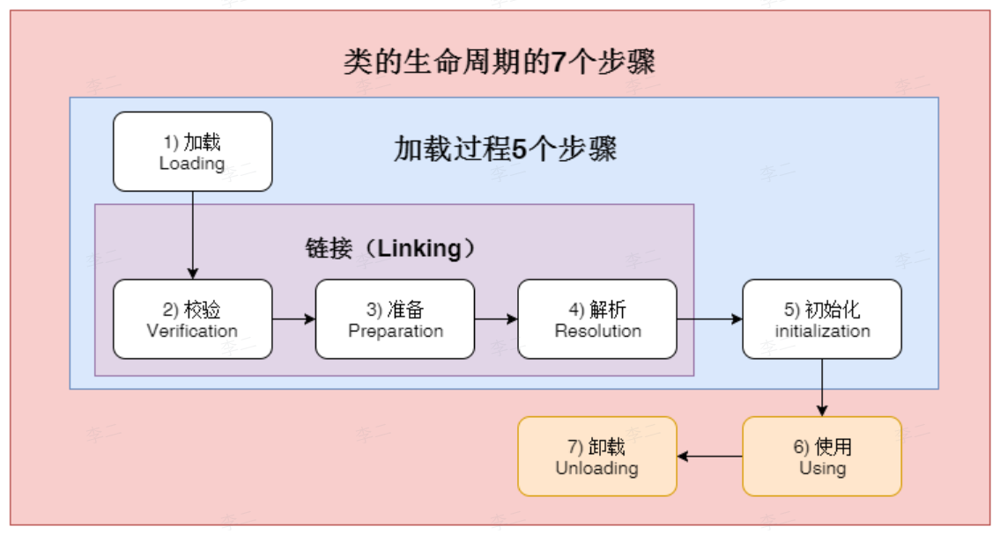
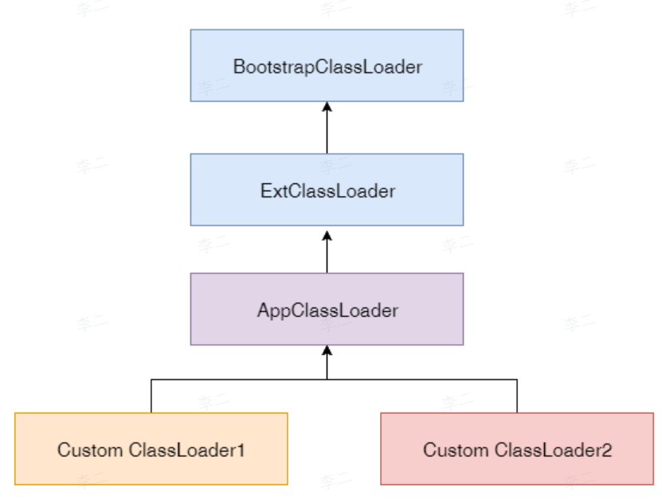

## 1  什么是类加载？类加载的过程是怎么样的？

类的加载指的是将类的 `class` 文件中的二进制数据读入到内存中，将其放在运行时数据区的方法区中，然后在堆内创建一个此类的 Class 对象，通过这个对象可以访问到方法区对应的类信息。

类的加载流程包括：加载、验证、准备、解析、初始化。其中验证、准备、解析统称为连接

### 1.1  加载

目的：将类的二进制字节流引入 JVM

具体步骤：

1. 通过类的全限定名获取定义该类的二进制字节流
2. 将字节流所代表的**静态存储结构**转换为**方法区的运行时数据结构**。
3. 在堆内存中生成一个该类的 `java.lang.Class` 对象，作为方法区类信息的访问入口。

> [!note]
> 加载阶段并未完全结束，类加载的某些动作（如验证）可能与这一阶段交叉进行

### 1.2  验证

目的：确保 Class 文件的字节流中包含的信息符合 JVM 规范，保证运行后不会危害到虚拟机自身安全。

主要包括四种验证：文件格式验证、元数据验证、字节码验证、符号引用验证。

- 文件格式验证：验证字节流是否符合 Class 文件格式规范
- 元数据验证：对字节码描述的信息进行语义分析，确保符合 Java 语言规范。比如，
	- 除了 `java.lang.Object` 类外的所有类都应当有父类；
	- 类是否继承了 `final` 类；
	- 接口是否实现了非抽象方法等。
- 字节码验证：分析类的方法体，也就是 Class 文件中的 code 属性，确保方法体中的字节码不会在运行时危害虚拟机
- 符号引用验证：发生在解析阶段，检查常量池中符号引用能否被正常解析。比如，引用的类/字段/方法是否存在，是否可以访问等。

### 1.3  准备

目的：为类变量分配内存并设置初始值

- 在方法区中为类变量分配内存
- 设置类变量初始值为默认零值。
- 特殊情况：当类变量被 `final` 修饰，并且该字段的 `ConstantValue` 属性在 Class 文件中已经指定，则在准备阶段直接赋值为指定的值，而非零值。

### 1.4  解析

目的：将常量池中的符号引用转换为直接引用

- 符号引用：以一组符号来描述目标，与内存布局无关，包括类名、方法名、字段名等。
- 直接引用：直接指向目标的指针、偏移量或句柄，与内存布局密切相关，是虚拟机真正可以使用的地址。

解析时机：

- 解析可以在类加载的连接阶段进行（早期绑定），也可以在运行时绑定（晚期绑定）
- JVM 规范允许，在初始化之后再进行解析。

### 1.5  初始化

目的：执行类中定义的 `Java` 代码，为类变量赋予开发者希望的值。

- 初始化阶段会执行 `<clinit>()` 方法
- 对于无静态变量和静态代码块的类，编译器可以不生成 `<clinit>()` 方法

执行顺序：

- 先执行父类的 `clinit()`
- 再执行子类的 `cliint()`
- `clinit()` 是线程安全的，多个线程同时初始化同一个类时，只有一个线程会执行，其他线程阻塞等待。

## 2  什么是双亲委派模型？

- 当一个类加载器接收到一个类的加载请求时，它首先不会自己尝试加载，而是将其委托给父类加载器去完成。这种委托关系会逐级向上传递，最终所有请求都会到达最顶层的**启动类加载器（Bootstrap ClassLoader）**。只有当父类加载器**无法完成加载**时，子类加载器才会尝试自己加载。
- 双亲委派模型的具体实现代码在 `java.lang.ClassLoad` 中。其中，`classload()` 的加载过程为：
	1. 检查该类是否已经被加载，如果没有加载，那么就委派给父类加载器去加载
	2. 当父类加载器加载失败，并抛出 `ClassNotFoundException` 时。子加载器尝试自己加载。

## 3  双亲委派模型的工作流程

1. 缓存检查
	- 当前类加载器首先调用 `findLoadedClass(name)` 方法，检查该类是否已经被自己加载过。
	- 如果已加载，直接返回缓存中 `Class` 对象。
2. 向上委派
	- 如果当前类加载器的缓存中没有该类，那么就将加载请求委托给父类加载器。
	- 父类加载器重复相同步骤：检查自己缓存 ->若没有则继续向上委派。
	- 该过程一直持续到最顶层的启动类加载器
3. 父类加载器尝试加载
	- 最顶级的父加载器（可能是启动器加载器）在自己的类路径 (classpath) 中搜索并尝试加载该类。
	- 如果找到

## 4  为什么需要双亲委派模型

### 4.1  核心原因：保证 Java 类型体系的唯一性和安全性

如果没有双亲委派模型，每个类加载器都可以独立加载同名的类，那么系统中会出现大量由不同加载器定义的、名称完全相同但实现不同的 `Class` 对象，这将严重破坏 Java 类型系统的根基。

### 4.2  四个核心维度

#### 4.2.1  保证核心类的安全——沙箱安全机制

- 问题场景：
	- 恶意用户可能自定义一个 `java.lang.String` 类，并在其中植入破坏性代码，如果自定义 `String` 类被加载，JVM 核心行为将被篡改。
- 双亲委派模式如何解决：
	- 当需要加载核心类，如 `java.lang.String` 类时，请求会逐步委派给启动类加载器 `Bootstrap ClassLoader`
	- 启动类加载器只会加载 JRE 核心库中的 `String` 类，并返回给调用者
	- 用户自定义的 `String` 类将永远不会被加载，从而保证了核心 API 的纯净和安全。
- 本质：通过委派机制，将最核心、最受信任的类交由最顶层的、由 C++ 实现的启动类加载器加载，构建了一道安全屏障。

#### 4.2.2  保证 Java 类型系统的唯一性——避免类型混乱

- 问题场景：
	- 如果没有双亲委派模式，应用类加载器和自定义类加载器各自加载一个 `com.example.User` 类，虽然包名、类名完全相同，但是是不同的类。
	- 当这两个 `User` 对象互相比较、类型转换时，会抛出 `ClassCastException`，因为 JVM 内部使用 `(类加载器，类全限定名)` 作为类的唯一标识。
- 双亲委派如何解决：
	- 由于所有的 `User` 类的加载请求最终都会委派到同一个加载器，因此整个系统只会存在一个 `User` 类
	- 所有的 `User` 类型一致，`equals`、`instanceof`、强制转换都得以正常工作。

#### 4.2.3  避免类的重复加载

- 问题场景：
	- 如果每个类加载器都独立加载 `java.util.HashMap`，那么系统中将会产生大量重复的 `HashMap.class` 实例，浪费内存，且每次加载都需要解析字节码，降低启动速度。
- 双亲委派如何解决：
	- 所有的加载请求都向上委派，子加载器无需重复加载父加载器已经加载过的类
	- 父加载器加载过的类会在 `ClassLoader` 缓存中直接返回，无需二次加载

#### 4.2.4  维护类加载器的层级有序性

- 双亲委派模型为类加载器定义了一套清晰的树状层级关系，使每个加载器职责分明：
	- 启动类加载器：加载 JRE 核心类
	- 扩展类加载器：加载 `lib/ext` 目录下的类
	- 应用加载器：加载 `classpath` 下的类
	- 自定义类加载器：加载特定路径或网络资源中的类
- 这种层级关系使得系统更易于维护和扩展，也方便排查类加载相关的问题。

## 5  双亲委派模型是如何避免类的重复加载的？

### 5.1  委派加载顺序

- 子类加载器收到加载请求后，**不会立即自己尝试加载**，而是逐级向上委派给父类加载器，直到最顶级的启动类加载器。
- 对于同一个类，无论从哪个位置发起加载请求，最终都将通过委派链传递给**同一个顶层加载器**完成加载。
- **效果**：确保了同一个类全限定名在 JVM 中只会被同一个加载器加载，从源头上避免了重复加载。

### 5.2  缓存机制

- **每个类加载器都维护一个独立的缓存表**，以类全限定名为 key，存储已经加载的类。
- 一旦加载完成，后续所有对该类的请求都会直接命中缓存，避免重复加载。
- **关键特性**：缓存是**每个加载器私有的**，子加载器**无法直接访问**父加载器的缓存。

### 5.3  缓存检查的完整流程

（1）子加载器收到加载请求

- 先调用 `findLoadedClass(name)` 检查**自己的缓存**。
- 如果已加载 → **直接返回**，不再向上委派。
- 如果未加载 → 继续向上委派给父加载器。

（2）父加载器收到委派请求

- 同样先检查**自己的缓存**。
- 如果已加载 → **直接返回**，不再继续向上。
- 如果未加载 → 继续向上委派给祖父加载器。

（3）依此类推，直到最顶级的启动类加载器

- 如果某个父加载器缓存中存在该类 → 直接返回（该类由该父加载器加载，**但不会存入子加载器的缓存**）。
- 如果所有父加载器都未找到 → 返回 `null`，最终由**最初发起请求的子加载器**调用 `findClass()` 自己加载。

## 6  什么情况下，会选择绕过双亲委派机制

### 6.1  答案

- **动态加载特定类**：开发者需要加载一些特定类，这些类不在标准的类路径中，或者是需要特殊的类加载逻辑。例如，在应用程序中动态从网络、数据库或特定的存储介质中加载类。
- **字节码生成、增强或修改类**：通过字节码操作框架对类进行动态生成，增强或修改，可能需要加载之前处理的类。例如，为了实现 AOP，就需要通过自定义类加载器来实现类的织入功能。
- **多版本兼容性**：当不同版本的类需要共存于同一个应用中时，可能需要绕过双亲委派机制来避免类加载冲突。例如，在大规模企业应用中，不同模块可能依赖于不同版本的同一库，这样可以通过定制的类加载器来确保正确版本被加载。

## 7  如何打破双亲委派模型？

### 7.1  自定义类加载器

- 通过继承 `java.lang.ClassLoader` 并重写类 `loadClass()` 方法，自定义类的加载逻辑。
- 比如，在 `loadClass` 方法中，直接调用 `findClass` 进行加载，而不再先向上委派，显然直接绕过了双亲委派机制

### 7.2  OSGI 与 Java 模块化系统 (Java Module System)

- OSGI，Open Service Gateway Initiative
	- 每个 OSGI 模块 (Bundle) 都拥有独立的加载器
	- 类的加载不遵循简单的向上委派，而是基于模块的依赖声明进行动态查找。
- JPMS，Java Module System
	- 自 JDK 9 引入，每个模块 `module-info.java` 定义自己的依赖关系
	- 类加载遵循模块边界，当跨模块访问时，会在模块层进行解析和委派，而不完全依赖于双亲委派链。

### 7.3  SPI 与线程上下文类加载器（TCCL）

- SPI(Service Provider Interface ) 是 Java 提供的一种服务发现机制，允许核心类库在运行时加载第三方提供的服务实现类
- 问题：
	- 核心类库由启动类加载器加载，而第三方实现类位于 `classpath` 中，由应用类加载器加载。而根据双亲委派模型，父加载器无法 " 看到 " 或 " 调用 " 子加载器加载的类。
	- 而 SPI 要求核心类库在运行时加载第三方服务实现类。也就是说，要求启动类加载器加载子应用类。
	- 因此，在加载时，自然会出现启动类加载器无法加载，且无法委派给子加载器，从而导致 `ClassNotFoundException`
- 线程上下文加载器就是解决方案
	- Java 为每个线程维护了一个线程上下文加载器，这个加载器可以通过 `Thread.getContextClassLoader()` 获取，通常是应用类加载器。
	- SPI 的核心类在加载类时，不通过自己的类加载器，而是通过 `Thread.currentThread().getContextClassLoader()` 获取对应的 TCCL，并用这个 TCCL 来加载服务实现类。
	- 这样，父加载器执行的加载请求，转而由子加载器完成，绕过了双亲委派模型。

## 8  哪些框架或中间件打破了双亲委派模型

- Tomcat：Tomcat 使用自定义的类加载器，用于隔离不同 Web 应用的类加载。每个 Web 应用都有自己的类加载器，能够加载同名的类而互不干扰。
- Spring Boot：Spring Boot 使用了自己的类加载机制，通过 `LaunchedURLClassLoader` 实现了自定义的类加载逻辑，特别是为了解决在 fat jar 中加载类的问题。
- OSGI：OSGI 框架中每一个模块都有自己的类加载器，能够加载同名但不同版本的类。

## 9  什么是类加载器？类加载器有哪些？

类加载器就是实现通过类的全限定名获取该类的二进制字节流的代码块

主要有四种类的加载器：

- **启动类加载器**：用于加载 Java 核心类库，无法被 Java 程序直接引用。
- **扩展类加载器**：用于加载 Java 的扩展库，也就是 `lib/ext` 目录下的类。
- **应用类加载器**：根据类路径 ( `classpath` ) 来加载 Java 类。可以通过 `ClassLoader.getSystemClassLoader()` 获取该加载器。
- **自定义类加载器**：加载自定义路径下的类。通过继承 `java.lang.ClassLoader` 来实现自定义类加载器。通过重写 `loadClass()` 方法，设置类加载的逻辑。在其中也可以指定类的加载路径。

## 10  如何判断两个类是否相等

### 10.1  核心标识

在 Java 虚拟机（JVM）内部，**一个类的唯一性是由 `(类加载器实例, 类的全限定名)` 这个二元组共同决定的**。

- 全限定名（Fully Qualified Name）：即包名 + 类名，如 `java.lang.String`。
- 类加载器实例（ClassLoader Instance）：即加载该类的具体类加载器对象。

因此，只有当同一类加载器加载的同名类才被视为相等类。如果两个类不是由统一类加载器加载，那么，即使这两个类来源于同一个 Class 文件，被相同的 JVM 加载，这两个类也不相等。

### 10.2  不同加载器导致类型不兼容的后果

如果两个同名类由不同加载器加载，它们在运行时被视为完全独立的类型。这会导致：

- **`instanceof` 判断失效**：一个类的实例用 `instanceof` 检查另一个同名类时，返回 `false`。
- **类型转换异常**：试图将 `ClassA`（由加载器 L1 加载）的实例强制转换为 `ClassA`（由加载器 L2 加载）时，会抛出 `ClassCastException`。
- **反射异常**：使用一个类的 `Class` 对象去反射获取另一个同名类的信息，虽然可能结构相同，但 JVM 依然视为不兼容。

## 11  类的实例化顺序

1. 类加载
	1. 父类静态成员（静态变量赋值、静态代码块，按代码顺序执行）
	2. 子类静态成员（静态变量赋值、静态代码块，按代码顺序执行）
2. 对象实例化
	1. 父类实例成员（实例对象赋值、普通代码块，按代码顺序执行）
	2. 父类构造方法（构造函数）
	3. 子类实例成员（实例对象赋值、普通代码块，按代码顺序执行）
	4. 子类构造方法（构造函数）
