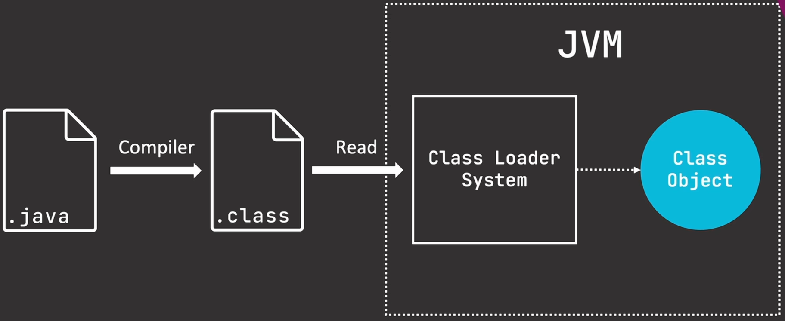

## 1  Class 对象

### 1.1  什么是 Class 对象



Class 是 JVM 在加载类时自动创建的，用于保存类的信息。

- `java.lang.Class` 是一个特殊泛型，其实例 (即 `Class` 对象) 代表了 JVM 中正在运行的某个类或接口的信息。
- 当 `.java` 文件被编译成 `.class` 文件后，JVM 在类加载阶段会读取该字节码，并在堆内存中自动创建唯一的一个 ==`Class` 类的实例==，用于封装该类的全部元数据。
- 通过该 `Class` 对象，可以访问类的结构，以及对类本身和类的实例对象进行操作
- 某类的 `Class` 对象，也被称为==**该类的类类型 (`class type`)**==

### 1.2  唯一性与不变性

- **全局唯一**：在同一个 **类加载器命名空间** 下，无论一个类被实例化多少次，JVM 都只会为其创建一个 Class 对象。
- **类加载器隔离**：若同一个字节码文件被**不同的类加载器**加载，JVM 会视为两个不同的类，此时会产生**两个不同的 Class 对象**。
int.class != Integer.class

- int.class 描述的是 `int` 这个原始数据类型的结构信息（如类型名、占用字节数、包装类是谁）。
    - 由于 `int` 并非对象，因此，`int.class` 没有实例
    - 试图实例化 `int.class` 会抛出 `InstantiationException` 异常
    - 基本数据类型 + `void` 的类类型是在 JVM 启动时创建的
- Integer.class 描述的是 `Integer` 这个包装类的结构信息
    - 类的类类型是在 JVM 的类加载器加载类时创建的

### 1.3  基础数据类型和 void 的类类型

JVM 在启动时会预先创建 **9 个特定的 Class 对象**，分别对应 8 种基本类型和 `void`。

八种基本类型和 `void` 类型并非是对象，但是他们却是存在对应的类类型 (Class 对象)。比如，`int` 的类类型为 `int.class`，void 的类类型为 `void.class`。

这些 Class 对象本身是一个普通的 Java 对象，描述了原始数据类型的结构信息（如类型名、占用字节数、包装类是谁）。

### 1.4  基本数据类型与 `void` 的类类型

#### 1.4.1  基本类型 Class 对象

在 Java 类型系统中，存在一个看似矛盾却合理的设计：**基本数据类型（Primitive Type）本身不是对象，但它们在 JVM 中都对应唯一的 `java.lang.Class` 实例**。这些 Class 对象是用于描述这些数据类型结构信息的元数据对象。

| 基本类型      | Class 字面常量      | 包装类的 `TYPE` 字段   |
| :-------- | :-------------- | :--------------- |
| `byte`    | `byte.class`    | `Byte.TYPE`      |
| `short`   | `short.class`   | `Short.TYPE`     |
| `int`     | `int.class`     | `Integer.TYPE`   |
| `long`    | `long.class`    | `Long.TYPE`      |
| `float`   | `float.class`   | `Float.TYPE`     |
| `double`  | `double.class`  | `Double.TYPE`    |
| `char`    | `char.class`    | `Character.TYPE` |
| `boolean` | `boolean.class` | `Boolean.TYPE`   |
| `void`    | `void.class`    | `Void.TYPE`      |

> [!tip]
> - JVM 在启动阶段会预先创建这 **9 个特定的 Class 对象**，并将其缓存在本地内存中。

#### 1.4.2  获取基本类型 Class 对象的两种

包装类的静态常量 `TYPE` 的值就是其对应的基础数据类型的 Class 对象。二者引用指向同一个 Class 对象。（因为 Class 对象是全局唯一的）

因此，获取基础数据类型的方式有两种

- `Class<?> c = 类型.class;`
- `Class<?> c = 包装类.TYPE;`

> [!WARNING] 注意
> `Class.forName("int")` 是**非法**的。基本类型的名称并未注册在类加载器的命名空间中。若需动态获取基本类型的 Class 对象，应使用包装类的 `TYPE` 字段，或通过 `Integer.class` 等引用类型的关联信息。

#### 1.4.3  为何需要为基本类型和 `void` 创建 Class 对象？

JVM 为基础类型和 `void` 创建 Class 对象是为了==在反射和泛型系统中统一处理类型==。如果缺少对基本类型的 Class 表示，以下核心机制将无法正常工作：

1.  **反射方法签名解析**：通过 `Method.getParameterTypes()` 获取方法参数类型列表时，若某个参数是 `int`，返回值中必须包含一个表示 `int` 的 Class 对象，否则反射 API 无法完整描述方法签名。
2.  **泛型与类型擦除后的补偿**：在反射中，泛型信息被擦除，但字段或方法的**确切类型**仍通过 Class 对象保存。基本类型 Class 使得框架（如序列化工具）能正确区分 `int` 字段和 `Integer` 字段。
3.  **数组类型的完整性**：`int[].class` 的组件类型（`getComponentType()`）返回的是 `int.class`。没有它，基本类型数组将无法通过反射进行元素级别的动态操作。
4.  **注解与元编程**：注解元素可以是基本类型，处理注解时同样需要通过 Class 对象来读取类型信息。

#### 1.4.4  int.class 和 Integer.class 的区别

| 特性                       | `int.class`       | `Integer.class`         |
| :----------------------- | :---------------- | :---------------------- |
| **代表的类型**                | 原始数据类型 `int`      | 包装类 `java.lang.Integer` |
| **是否有实例**                | 无，`int` 不是对象      | 有，`Integer` 是对象         |
| **Class 对象唯一性**          | 全局唯一（由 JVM 启动时创建） | 全局唯一（由类加载器加载）           |
| **`isPrimitive()` 返回值**  | `true`            | `false`                 |
| **`getName()` 返回值**      | `"int"`           | `"java.lang.Integer"`   |
| **能否用于 `newInstance()`** | 不可以，不存在构造函数       | 可以                      |

### 1.5  反射包

反射的操作位于 `java.lang.reflect` 包中，包内的核心接口和类如下：

- `Member` 接口：反映关于单个成员 (字段或方法) 或构造函数的标识信息。
- `Field`：提供一个类的 field 的信息以及访问类的 field 的接口。
- `Method`：提供一个类的方法的信息以及访问类的方法的接口。
- `Constructor`: 提供一个类的构造函数的信息以及访问类的构造函数的接口。
- `Array`: 该类提供动态地生成和访问 JAVA 数组的方法。
- `Modifier` : 提供了 static 方法和常量，对类和成员访问修饰符进行解码。
- `Proxy`: 提供动态地生成代理类和类实例的静态方法。

## 2  获取 Class 对象 的四种方法

### 2.1  使用类字面常量获取 (编译时已知具体类)

在编译期进行绑定，属于静态引用。

```java
Class<类名> name = 类名.class; 
```

- 由于，在编译期就已经知道数据是 `类名` 的类型，因此，Class 中的泛型参数直接为类名。
- 由于，泛型类型是明确的，因此，性能上最好的
- 使用该方式获取类的 Class 对象时，不会**触发类的初始化** (仅加载)。
- 任何一个类都有一个隐含的静态成员变量 `class`

### 2.2  通过类加载器传入类路径获取

```java
String str = "org.Reflection.User";
Class<?> clazz = ClassLoader.getSystemClassLoader().loadClass(str);
```

- 通过该方式获取 Class 对象时，不会触发类的初始化

### 2.3  通过实例对象获取 (运行时已知对象)

运行时获取，通过类的实例对象反推 Class 对象。

```java
Class<?> name = 类实例对象.getClass();
```

- 泛型参数使用通配符 `?`

> [!question] 泛型类型为什么要使用通配符，而不是直接指定具体类型？
> - 因为，该 Class 对象是在运行时从类实例对象获取的。而类实例的具体类型只有在运行时创建和确定，而无法在编译时确定。因此只能使用通配符，以表示未知类型。
> - 如果将其改为具体的 `类名`，则会报错

### 2.4  通过类的全限定名字符串获取 (运行时动态加载)

通过==类的全限定名字符串==在运行时动态加载指定的类，并返回该类的 Class 对象实例。会触发类的实例化。通常用于配置文件场景中。

```java
Class name = null;
try{
    name = Class.forName("org.Reflection.User");
}catch (ClassNotFoundException cnfe){
    // todo…
    cnfe.printStackTrace();
}
```

- 泛型参数使用通配符 `?`：因为运行时才能确定类型
- `类名`：待加载类的全限定名字符串

> [!note] 类的静态加载和动态加载
> - 静态加载：在编译期就必须确定的类的依赖关系，并由 JVM 在类加载阶段将 `.class` 读入内存的过程。
> 	- 所有通过 `new` 关键字、操作静态字段或调用静态方法而引用的类，都属于静态加载
> 	- 特点
> 		- 编译期检查：编译器会验证被引用的类是否存在
> 		- 及早绑定：类与类的依赖关系在字节码层面上被硬编码成全限定名，无法在运行时修改
> 		- 全量加载：只要是静态加载的类，编译期就必须存在并且可访问
> - 动态加载：在程序运行过程中，通过类名字符串显式请求 JVM 加载某个类。典型例子是反射机制中的 `Class.forName()` 方法
> 	- 特点
> 		- 运行时决议：只有 `forName()` 方法执行，才决定类名
> 		- 延迟错误暴露：编译期不检查类不存在和依赖缺失问题，只有在运行时才会抛出 `ClassNotFoundException` 异常
> 		- 按需加载：只有 `ClassName()` 真正被执行时，目标类才会被加载和初始化

## 3  Class 对象的成员方法

### 3.1  字段

用于获取 Class 对象对应类的字段

```java
// 获取当前类的所有字段（含私有），不限制访问权限，不包括从父类继承的字段
Field[] fields = clazz.getDeclaredFields()
Field field = clazz.getDeclaredFiled(“字段名”) // 指定的单个字段

// 仅获取类的公共(public)字段，包括从父类继承的字段
Field[] fields = clazz.getFields() 
Field field = clazz.getFiled(“字段名”) // 指定的单个字段
```

- 返回值：`Field[]` 、`Field`

#### 3.1.1  get 方法

```java
// 获取字段名称
field.getName();
field.getSimpleName(); // 不包含包名

// 获取字段的类类型
field.getType();

// 获取泛型类类型
field.getGenericType();

// 获取普通成员值
field.get(obj); 
// 如果 field 是静态属性，则 obj 为 null;
// 否则为类对象
```

- `getType` 获取泛型字段时，获取到的是类型擦除后的类型

#### 3.1.2  set 方法

```java
// 设置访问权限
field.setAccessible(true); // 访问私有属性时，需要先获取访问权限

// 设置普通成员值
field.set(obj, value); // obj是类实例对象
// 如果 field 是静态属性，则 obj 为 null;
```

### 3.2  方法

获取当前类的方法

```java
// 获取当前类的所有方法，不限制访问权限，不包括从父类继承的方法
Method[] methods = clazz.getDeclaredMethods() 
// 指定的单个方法
// 无参方法
Method method = clazz.getDeclaredMethod(“函数名”);
// 带参方法
Method method = clazz.getDeclaredMethod(“函数名”, Class<?>… parameterTypes); 

// 获取类的公共方法，包括从父类继承的方法，只要访问权限是 public
getMethods() 
// 获取指定的单个方法
getMethod(“函数名”)
getMethod(“函数名”, Class<?>… parameterTypes); // 带参
```

- `Class<?>… parameterTypes`：数据类型的类类型列表，对应方法的参数列表
	- 比如方法的参数列表为 `(int a, String b)`
	- 则，对应的类类型列表为 `int.class, String.class`
	- 可以传入多个类类型，也可以传入一个 Class 对象数组
- 返回值：`Method[]`、`Method`

> [!note] int.class != Integer.class
> - int.class 描述的是 `int` 这个原始数据类型的结构信息（如类型名、占用字节数、包装类是谁）。
> 	- 由于 `int` 并非对象，因此，`int.class` 没有实例
> 	- 试图实例化 `int.class` 会抛出 `InstantiationException` 异常
> 	- 基本数据类型 + `void` 的类类型是在 JVM 启动时创建的
> - Integer.class 描述的是 `Integer` 这个包装类的结构信息
> 	- 类的类类型是在 JVM 的类加载器加载类时创建的

#### 3.2.1  get 方法

```java
// 获取函数名 
method.getName();

// 获取返回值类型的类类型
Class<?> mrtClass = method.getReturnType(); // 对于基本数据类型和 void 直接返回类型名
String mrtName =  method.getReturnType().getName(); // 获取返回值类型

// 获取参数列表的类类型
Class<?>[] parameters = method.getParameterTypes();
```

#### 3.2.2  关键操作

```java
// 获取访问权限 
method.setAccessible(true); // 访问私有函数，首先要申请访问权限

// 无参函数 
method.invoke(obj); // 静态方法 obj 为 null，否则，obj 为类对象

// 带参函数 
method.invoke(Object obj, Object… args); // args 通过 getParameterTypes() 获取 
```

- `Object… args`：可以传入多个参数，也可以传入一个 Object 数组

### 3.3  构造器

获取当前类的构造方法

```java
// 获取当前类的所有构造器，不限制访问权限，不包括从父类继承的构造器
Constructor<?>[] constructors = clazz.getDeclaredConstructors()
// 无参构造器
Constructor<?> constructor = clazz.getDeclaredConstructor()
// 有参构造器
Constructor<?> constructor = clazz.getDeclaredConstructor(Class<?>… parameterTypes)

// 获取类的公共构造器
getConstructors()
getConstructor()
getConstructor(Class<?>… parameterTypes)
```

- `Class<?>… parameterTypes`：就是构造函数参数数据类型的类类型列表
	- 比如，构造函数的参数类型列表为：String 和 int
	- 那么，传入参数为 `String.class, int.class`
- 返回值：`Constructor<?>[]` 和 `Constructor<?>`

#### 3.3.1  生成实例对象

```java
Object obj = constructor.newInstance(obj, ...paramenters);
```

#### 3.3.2  向下转型

```java
// 向下转型 1： 强制类型转换
if(obj instance 类名)
	类名 类实例对象名 = （类名） obj;
	
// 向下转型 2： 通过 Class 的 cast 方法
类名 类实例对象名 = clazz.cast(obj);
```

- 使用 `cast` 方法的注意事项
	- 调用 `cast` 的类方法，一定是**通过类字面常量获得的 Class 对象**
	- 也就是说，`Class<类名> clazz = 类名.class;`
- 向下转型，存在类型安全隐患。
	- 因此，如果有约定类的标准的话，才可以进行类型转换
	- 比如，限制获取到的类为 Word 类和 Excel 类，二者都继承或实现 Office 类
	- 那么，获取到的类 obj 就可以类型转换为 Office 类，从而解决了类型安全的问题

```java
// 示例：安全地处理 Word 和 Excel 类
if (Office.class.isAssignableFrom(clazz)) {
    Office officeInstance = (Office) clazz.getDeclaredConstructor().newInstance();
    officeInstance.open(); // 调用接口方法，消除类型不确定性带来的安全隐患
}
```

> [!TIP]
> - 虽然可以通过类型转换直接获取类实例对象，但这并不是使用反射的最佳实践
> - 建议==**使用反射，直接调用和操作对象的字段和方法**==
> - 因为，如果已经知道了对象的类型，那么直接显式调用更加合适，而没必要使用反射
> - 反射真正的价值在于：处理编译时未知的类型，从而编写更通用的代码

#### 3.3.3  判断是否为某个类的实例

两种方式

```java
// 1. 关键字 instanceof
obj instanceof 类名

// 2. Class 对象调用 isInstance() 方法
Class对象.isInstance(obj)
```

案例

```java
String str = "org.Reflection.User";
Class<?> clazz = Class.forName(str);

Constructor<?> constructor = clazz.getDeclaredConstructor(String.class, int.class);
Object obj = constructor.newInstance("name", 18);
Object objFake = null;

// instanceof
System.out.println(obj instanceof User);
System.out.println(objFake instanceof User);

//isInstanc
System.out.println(clazz.isInstance(obj));
System.out.println(clazz.isInstance(objFake));
```

### 3.4  注解

可以在运行时读取类、方法或字段上的注解信息

```java
// 获取当前类的所有注解，不包括父类中的注解
obj.getDeclaredAnnotations()
obj.getDeclaredAnnotation("注解名")

// 获取类的公共注解
getAnnotations()
getAnnotation()
```

- obj 可以是类、方法或字段

### 3.5  获得父类 Class 对象

```java
obj.getSuperClass()
```

- `obj` 是子类的实例对象
- 返回值：直接父类的 Class 对象

### 3.6  Array

语法

```java
// 1 创建
Object array = Array.newInstance(类类型, len);

// 2 添加
array.set(array, index, value);

// 3 访问
Array.get(array, index);
```

## 4  反射访问字段和方法的步骤

### 4.1  访问字段

#### 4.1.1  访问静态字段

```java
// 1. 获取 Class 对象
Class<?> classObj = Class.forName("org.Reflection.User");
// 2. 访问属性
Field[] fields = classObj.getDeclaredFields();
Field field = classObj.getDeclaredField("publicStaticField");
// 3. 操作属性
System.out.println(field.getName()+ " : " + field.get(null));
```

#### 4.1.2  访问实例字段

```java
// 1. 获取 Class 对象
Class<?> classObj = Class.forName("org.Reflection.User");
// 2. 获取构造器
Constructor<?> constructor = classObj.getDeclaredConstructor(String.class, int.class);
// 3. 获取实例对象
Object obj = constructor.newInstance("Lee", 20);
// 4. 访问属性
Field[] fields = classObj.getDeclaredFields();
Field field = classObj.getDeclaredField("name");
// 5. 操作属性
System.out.println(field.getName()+ " : " + field.get(obj));
```

### 4.2  访问方法

#### 4.2.1  访问静态方法

```java
// 1. 获取 Class 对象
Class<?> classObj = Class.forName("org.Reflection.User");
// 2. 访问方法
Method method = classObj.getDeclaredMethod("myPrivateStaticMethd", String.class);
// 3. 操作方法
method.setAccessible(true); // 获取访问权限，只有当访问权限没有时需要，比如当方法为私有、final时需要
method.invoke(null, "hello World"); // 带参数的 private
```

#### 4.2.2  访问实例对象方法

```java
// 1. 获取 Class 对象
Class<?> classObj = Class.forName("org.Reflection.User");
// 2. 获取构造器
Constructor<?> constructor = classObj.getDeclaredConstructor(String.class, int.class);
// 3. 获取实例对象
Object obj = constructor.newInstance("Lee", 20);
// 4. 访问方法
Method method = classObj.getDeclaredMethod("myPrivateMethod", String.class, String.class);
Method method2 = classObj.getDeclaredMethod("myPublicMethod");
// 5. 操作方法
method.setAccessible(true); // 获取访问权限，只有当访问权限没有时需要，比如当方法为私有、final时需要
method.invoke(obj, "hello World", "mark2"); // 带参数的 private
method2.invoke(obj); // 无参 public
```

## 5  反射机制的理解

### 5.1  反射的核心价值：从静态绑定到动态绑定

在常规的 Java 编程模式中，开发者通过 `new` 关键字显式创建类的实例对象，并基于该实例直接调用其属性与方法。这种方式的调用关系在**编译期**即已确定，属于**静态绑定**。

但是，静态绑定存在明显的局限性;

- 代码固化：一旦完成编译和部署，类实例的创建方式、方法的调用逻辑难以更改
- 扩展性受限：无法在程序运行过程中，根据配置文件、用户输入或外部环境的变化，动态地创建未知类型的对象或调用未知名称的方法。

### 5.2  反射的动态特性：将调用逻辑参数化

反射的核心思想在于：**将对类成员（字段、方法、构造器）的访问与调用，从硬编码的符号引用转换为基于字符串标识的动态解析**。

具体表现为：

- **类加载的动态化**：通过 `Class.forName("全限定类名")` 根据字符串名称获取 `Class` 对象，而非依赖 `import` 语句。
- **实例化的动态化**：通过 `Class.newInstance()` 或 `Constructor.newInstance()` 创建对象，无需在代码中写明具体的构造器调用。
- **访问的动态化**：通过 `Method.invoke()` 和 `Field.set()/get()` 操作成员，方法名和字段名以字符串形式传入。

### 5.3  反射和注解的协同作用

反射的强大之处不仅在于直接操作字符串，更在于其与**注解（Annotation）**的完美结合。

- **元数据的提取**：反射允许在运行时通过 `getDeclaredAnnotation()` 等方法读取类、方法或字段上附加的注解信息。
- **声明式编程的实现**：开发者可以在代码中使用注解进行声明（例如标记某个方法为 `@Bean`，标记某个字段需 `@Autowired`），而具体的**执行逻辑**则由底层的反射框架统一解析注解并完成操作。

这种模式将 " 做什么 "（声明）与 " 怎么做 "（反射实现）分离开来，是构建现代 Java 框架（如 Spring IoC 容器、JUnit 测试框架、ORM 映射工具）的基石。

### 5.4  反射的应用场景

- 开发通用框架
- 动态代理
- 注解
- 可扩展功能：应用程序可以通过使用完全限定名称创建可扩展性对象实例来使用外部的用户定义类。

### 5.5  反射的缺点

- 性能开销：由于反射涉及动态解析的类型，因此无法执行某些 Java 虚拟机优化。
- 破坏封装性：`setAccessible` 可以修改成员的访问权限，从而使得反射可以绕开权限检查
- 内部曝光：反射允许代码执行在正常调用时的非法操作（比如操作 private 成员），这可能存在一些意想不到的副作用。同时，反射代码打破了抽象，可能会随着平台升级而改变行为。
