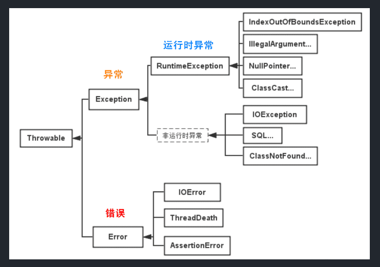

## 1  异常的层次结构

- JAVA 的异常体系是一棵以 `java.lang.Throwable` 为根的树



### 1.1  根节点：Throwable

Throwable 是 JAVA 中所有错误和异常的超类

- `Throwable` 包含了异常发生时线程的执行堆栈，其提供了 `printStack Trace()` 等接口用于获取堆栈跟踪数据等信息

- `Throwable` 包含两个子类：`Error` 和 `Exception`

### 1.2  分支 1：Error

Error 是程序中无法处理的错误，表示程序运行时 JVM 层面的严重错误，通常是不可恢复的

- 应用程序不应该尝试捕获或处理此类错误
- 发生时，JVM 将终止线程，甚至是整个程序

### 1.3  分支 2：Exception

Exception 是程序本身可以捕获并且可以处理的异常，分为两类：

| 分类   | 受检异常                                                    | 非受检异常                                                                           |
| :--- | :------------------------------------------------------ | :------------------------------------------------------------------------------ |
| 别名   | 编译时异常                                                   | 运行时异常                                                                           |
| 继承关系 | `Exception` 及其子类（不含 `RuntimeException`）                 | `RuntimeException` 及其子类                                                         |
| 典型代表 | `IOException`, `SQLException`, `ClassNotFoundException` | `NullPointerException`, `IndexOutOfBoundsException`, `IllegalArgumentException` |
| 处理要求 | 强制处理。编译器强制要求使用 `try-catch` 捕获或 `throws` 声明，否则编译不通过。     | 非强制。编译器不检查。通常由逻辑错误引起，应通过优化代码逻辑来避免。                                              |
| 设计理念 | 外部原因导致（如文件不存在、网络中断），程序无法控制但可预见。                         | 内部逻辑错误（如空指针、越界），程序应尽可能避免。                                                       |

## 2  异常基础

### 2.1  异常关键字

- `try`：用于监听。将要被监听的代码 (可能抛出异常的代码) 放在 try 语句块之内，当 try 语句块内发生异常时，异常就被抛出。
- `catch`：用于捕获异常。catch 用来捕获 try 语句块中发生的异常。
- `finally`：**finally 语句块总是会被执行**。
  - 它主要用于回收在 try 块里打开的物力资源 (如数据库连接、网络连接和磁盘文件)。
  - 只有 finally 块，执行完成之后，才会回来执行 try 或者 catch 块中的 return 或者 throw 语句，如果 finally 中使用了 return 或者 throw 等终止方法的语句，则就不会跳回执行，直接停止。
- `throw`：用于抛出异常。
- `throws`：用在方法签名中，用于声明该方法可能抛出的异常。

### 2.2  异常捕获 try-catch-finally

这是防御性编程的核心结构

#### 2.2.1  try

- `try`：用于监听可能抛出异常的 " 危险 " 代码
- 当 `try` 块内的某条语句引发异常后，该语句之后的其余代码将立即停止执行。

#### 2.2.2  catch

- `catch`：捕获并处理特定类型的异常。
- 多重捕获
	- 可以通过多个 catch 捕获多个异常，并对不同类型的异常做不同处理。
	- 也可以在同一个 catch 中捕获多种类型的异常，通过 `|` 进行分隔
- 匹配规则
	- 就近匹配：抛出异常的时候，异常处理系统会按照代码的书写顺序找出 " 最近 " 的处理程序。找到匹配的处理程序之后，它就认为异常将得到处理，然后就不再继续查找。
	- 异常条件的匹配并不要求抛出的异常同条件内的异常完全一致。派生类的异常也可以匹配其基类的处理程序。（派生类异常属于基类异常的子集）
- 匹配建议：将更具体的异常前置
	- 由于上述匹配规则，如果将基类异常的 catch 子句放在其派生类异常的 catch 子句前面的话，就会导致这个派生类 catch 子句永远也得不到运行。
	- 因此，catch 子句处理的异常顺序应该是**从更具体的异常到范围越来越大的异常**。

#### 2.2.3  finally

- `finally`：通常用于资源清理、状态重置或计数更新。无论是否发生异常，或者 `try` 或 `catch` 中是否存在 `return` 语句，`finally` 代码块总是会执行。
	- finally 代码块不执行的特殊情况
	    - 在前面代码中使用了 `System.exit(0)` 导致退出程序
	    - 线程被杀死或 CPU 关闭
	    - `finally` 块中出现异常

```java
private static void Method(args) {
    
    try{
        // todo ...
    } catch (异常类型 e1){
        // 处理 1
    } catch (异常类型 e2 | 异常类型 e3){
        // 处理 2
    } finally{
        // 此处代码一般情况下一定会执行
    }
}
```

执行顺序

1. try 没有捕获到异常时
	   1. try 中语句
	   2. catch 中语句将不会执行
	   3. finally 中语句
	   4. 其后语句
2. try 捕获到异常时
	   1. 没有捕获该异常的 catch
	      1. 此异常将会抛给 JVM 处理，finally 语句块里的语句还是会被执行，但 finally 语句块后的语句不会被执行；
	   2. 有捕获该异常的 catch
	      1. try 中语句，异常发生前顺序执行，异常发生后的语句将不会被执行
	      2. 异常发生时，与 catch 语句块逐一匹配。对应 catch 语句块内语句顺序执行，其他 catch 将不会执行
	      3. finally 中语句

> [!Warnning] 异常或返回值丢失
> 严禁在 finally 中使用 `return` 语句。这会导致丢失 try 或 `catch` 中的返回值或异常，导致严重的逻辑错误

案例：异常丢失

```java
public class ExceptionSilencer {
    public static void main(String[] args) {
        try{
            throw new RuntimeException();
        }finally {
	        // 由于在这里直接 return 了，因此 try 中的异常直接丢失了
            return;
        }
    }
}
```

### 2.3  异常声明 throws

`throws` 用于在**方法签名**中声明该方法可能抛出的**受检异常**（Checked Exception），将异常处理责任转移给调用者。

#### 2.3.1  语法格式

```java
public void method() throws IOException, FileNotFoundException{
    //something statements
}
```

- 可以声明多个异常类，用 `,` 分隔。

#### 2.3.2  核心规则

- 对于受检异常：如果方法内产生了受检异常，并且要**抛出**该异常，则必须使用 `throws` 声明，否则编译不通过。
	- 如果在方法内没有对异常进行捕获和处理，则必须使用 `throws` 声明。
	- 如果在方法内对异常进行了捕获和处理，并没有通过 `throw` 手动抛出异常，那么，是不需要 throws 声明的。
	- 如果在方法内对异常进行了捕获和处理，同时也通过 `throw` 手动抛出，那么，必须使用 `throws` 声明
- 对于非受检异常：`RuntimeException` 及其子类无需 `throws` 声明（编译不检查），JVM 会在运行时自动向上抛出。
- 责任转移：将异常处理的责任推给上层调用者。
- 当子类重写父类方法时，
	- 可以不声明异常
	- 可以声明与父类方法相同的异常，或其子类异常。
	- 严禁声明新的受查异常，或声明比父类更宽泛的异常（即父类异常的超类）。

#### 2.3.3  使用建议

- 仅在无法处理异常时使用 `throws` 向上传递
- 对于框架层或工具类，通常将底层异常转换为自定义业务异常后 `throws` 给上层

### 2.4  异常抛出 throw

- `throw` 用于主动抛出一个异常实例，可以是受检异常或非受检异常。
- 也就是说，如果代码可能会引发某种错误，可以创建一个合适的异常类实例并抛出它。

```java
public static double method(int value) {
    if(value == 0) {
        throw new ArithmeticException("参数不能为0"); //抛出一个运行时异常
    }
    return 5.0 / value;
}
```

- 大部分情况下，不需要手动抛出异常，JVM 库或底层库会自动抛出
- 手动抛出受检异常时，方法签名必须使用 `throws` 声明该异常或异常父类
- 手动抛出非受检异常时，方法签名可以不声明

#### 2.4.1  使用场景

- 参数校验：在用户输入和程序状态违反了业务规则时，底层库无法发现错误，需要手动抛出异常 `IllegalArgumentException`
- 特定逻辑中断：当程序进入到一个不应该进入的状态时，抛出 `IllegalStateException`  
- 异常包装与抽象：将捕获到的底层异常，包装为自定义业务异常，然后将其抛出，以避免底层细节暴露。
- 职责转移：将不想处理的

    ```java
    private static void readFile(String filePath) throws MyException {    
        try {
            // code
        } catch (IOException e) {
            MyException ex = new MyException("read file failed.");
            ex.initCause(e);
            throw ex;
        }
    }
    ```

### 2.5  资源清理

#### 2.5.1  传统方法 try-finally

为什么要使用 try-finally 进行资源清理，Java 不是有资源自动回收机制吗？

- 因为在 Java 中除了内存的清理之外，所有的清理都不会自动发生。

问题：finally 中的 `close()` 函数可能抛出异常，这将覆盖原始异常

- 案例：

```java
package org.exception;

class VeryImportantException extends Exception{
    @Override
    public String toString(){
        return "非常重要的错误";
    }
}
class HoHumException extends Exception{
    @Override
    public String toString(){
        return "A trivial exception";
    }
}

public class LostMessage{
    void f() throws VeryImportantException{
        throw new VeryImportantException();
    }
    void dispose() throws HoHumException{
        throw new HoHumException();
    }

    public static void main(String[] args){
        try{
            LostMessage lm = new LostMessage();
            try {
                lm.f();
            }finally {
                lm.dispose();
            }
        }catch (VeryImportantException | HoHumException e){
            System.out.println(e);
        }
    }
}
```

问题 2: 对象的构造时捕获异常，不应在 finally 处对资源进行释放

- 因为对象不一定创建完成，但是 finally 代码块总是会执行。
- 如果将资源清理的任务放在 finally 代码块中，就会导致明明对象没有创建完成却要清理的情况

解决方案 1: 使用嵌套 try 子句

在创建需要清理的对象之后，立即进入一个 `try-finally` 语句块

```java
package org.exception;

public class Cleanup {
    public static void main(String[] args) {
        try{
            InputFile in = new InputFile("src/org/exception/a.txt");
            try{
                String s;
                int i = 1;
                while((s = in.getLine()) != null){
                    ; // todo…
                }
            }catch (Exception e){
                System.out.println("Caught Exception in main");
                e.printStackTrace(System.out);
            }finally {
	            // 如果 in 构造成功，该 finally 才会执行 
                in.dispose(); // 清理 in
            }
        }catch (Exception e){
	        // 如果 in 构造失败，则会跳入到该分支
            System.out.println("InputFile 构造失败");
        }
    }
}
```

解决方案 2: 使用 try-with-resource

#### 2.5.2  try-with-resource（JAVA 7+）

- 适用于实现了 `AutoCloseable` 或 `Closeable` 接口的资源类（如文件流、数据库链接、网络套接字等）。
- 在资源规范头中声明的资源，将会在 try 代码块结束后自动调用 `close()` 方法，无论是否发生异常。
	- 资源规范头：try 后 `()` 内的部分称为资源规范头。

```java
package org.exception;

import java.io.*;

public class TryWithResources {
    public static void main(String[] args) throws IOException{
        try (InputStream in = new FileInputStream("src/org/exception/a.txt")){
            int contents = in.read();
        }
    }
}
```

`AutoCloseable` 和 `Closeable`

- 自 Java 7 后， `Closeable` 接口继承了 `AutoCloseable` 接口，因此所有实现了 `Closeable` 接口的资源，也同样支持 `try-with-resources` 特性。
- `AutoCloseable` 接口只有一个方法 `void close() throws Exception`。

特性

- 自动关闭顺序：
	- 如果 `try` 子句中创建了多个资源，它们会按照**创建的逆序**自动关闭，以避免依赖性问题。
	- 只要对象以及成功创建，那么他们就会以逆序的方式关闭，即使其中某个资源在关闭时出现了异常。
- 自动抑制：
	- `AutoCloseable` 接口中的 `close()` 方法仍然可能出现异常。
	- 但，其出现的异常会被抑制。也就是说，如果 `try-catch-finally` 代码块中抛出异常时，`close()` 抛出的异常不会覆盖主异常
	- 该异常会通过 `Throwable.addSuppressed()` 方法附加到主异常上，成为被抑制的异常列表中的一员。
	- 调用主异常的 `getSuppressed()` 方法可以获得被抑制的异常列表。

注意：

- 只有在资源规范头内创建的，且继承了 `AutoCloseable` 的资源类，才会在 try 子句结束后自动关闭。
- 也就是说，如果资源类是在 `try` 主体（`{}` 中）创建的，将不适用 `try-with-resources` 机制

## 3  自定义异常

当标准异常无法表达业务含义时，创建自定义异常。

- **规范**：继承 `Exception`（受检）或 `RuntimeException`（非受检）。
- **构造器**：至少包含无参构造和 `String message` 构造，建议包含 `Throwable cause` 构造以支持异常链。

```java
public class MyException extends Exception {
    // 无参构造
    public MyException(){ } 
    // 包含详细信息的有参构造
    public MyException(String msg){ 
        super(msg);
    }
    // 
    public MyException(String msg, 异常类型 e){ 
        // 处理
    }
}
```
