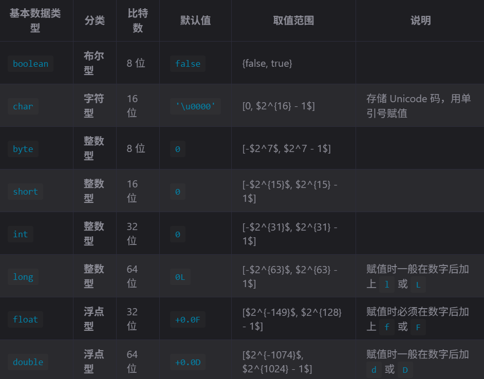

## 1  数据类型分类

Java 中的数据类型有两类

- 值类型（基本数据类型）：变量直接存储具体数值
- 引用类型：变量存储对象内存地址。除值类型外，都是引用类型，包括 `String`、数组等

## 2  值类型

Java 具有 8 种基本类型



> - **精度排序**：byte < short, char < int < long < float < double
> - **特殊说明**：仅 `boolean` 和 `char` 为无符号类型，且 `boolean` 不参与任何类型转换

## 3  值类型和引用类型的区别

| 维度     | 基本数据类型                   | 引用类型                                |
| -------- | ------------------------------ | --------------------------------------- |
| 存储内容 | 直接存储数值                   | 存储对象内存地址                        |
| 内存分配 | 声明时立即分配内存             | 声明时不分配，指向对象时才分配          |
| 默认值   | 各类型对应默认值（如 0、false） | `null`                                  |
| 判等操作 | 使用 `==` 比较数值             | 使用 `equals()` 比较内容，`==` 比较地址 |
| 赋值特性 | 必须赋具体值                   | 可赋 `null`d                            |

## 4  类型转换机制

Java 中数据类型转换有两种方式

- 自动转换
- 强制转换

### 4.1  自动类型转换

转换条件：

1. 目标类型精度 ≥ 源类型
2. 转换前后数据兼容 (boolean 不参与类型转换)
3. 转换后不会导致精度丢失

> 为什么 boolean 不参与类型转换？
>
> ---
>
> 因为，boolean 类型的数据只有 true 和 false 两种值

转换路径

```txt
byte -> short/char -> int -> long -> float -> double
```

### 4.2  强制类型转换

在不符合自动转换条件时，根据用户的需要，通过 `()` 运算符可以对数据类型进行强制类型转换。

语法：

```java
typeName var = (typeName) value; // value 为非 typeName 类型变量
```

- 如果从精度高的数据转换为精度低的数据，则可能导致数据丢失或溢出

## 5  装箱和拆箱

### 5.1  包装类、装箱、拆箱

Java 为每一种基本数据类型提供了对应的包装类

| 基本数据类型 | 包装类    |
| ------------ | --------- |
| byte         | Byte      |
| short        | Short     |
| int          | Integer   |
| long         | Long      |
| float        | Float     |
| double       | Double    |
| char         | Character |
| boolean      | Boolean   |

引入包装类的目的：提供一种机制，使得基本数据类型和引用类型可以互相转换

包装类和 String 一样都是不可变类型。

基本数据类型和引用类型的转换被称为装箱和拆箱

- 装箱：基本类型 -> 包装类。(调用 `valueof()` )
- 拆箱：包装类 -> 基本类型。(调用 `xxxValue()`)
  - 其中 `xxx` 为对应的数据类型，比如 `intValue`

### 5.2  自动装箱、自动拆箱

自 JDK 5 开始提供自动装箱/拆箱的功能，该设计依赖于享元模式。

```java
int i = 10;

// JDK 5 之前，手动装箱
Integer i1 = new Integer(i);
Integer i2 = Integer.valueOf(i);

// JDK 5 之后，自动装箱
Integer i3 = i;

// 手动拆箱
int i4 = i1.intValue();

// 自动拆箱
int i5 = i1;
```

#### 5.2.1  应用场景

- 调用一个含 `Object` 参数的方法，当需要将一个值类型传入时，需要装箱。
- 一个非泛型容器，元素类型为 `Object`，需要将值类型数据加入容器时，需要装箱。
- 当 `==` 运算符的两个操作数都是包装器的引用时，比较的是二者是否为同一个对象。但是，其中有一个操作数是表达式或值类型数据时，则会触发自动拆箱过程，最终比较的是数值。
- equals() 方法不会进行类型转换，只比较数值

#### 5.2.2  注意

- 装箱会创建对象，频繁的装箱操作会造成不必要的内存消耗，影响性能。所以应避免装箱。
- 基础数据类型比较使用 `==`，包装类比较使用 `equals` 方法

> 问题：谈谈 `Integer i = new Integer(xxx)` 和 `Integer i =xxx;` 这两种方式的区别
>
> - 第一种方式不会触发自动装箱过程；第二种方式会触发
> - 在执行效率和资源占用上，通常第二种方式优于第一种方式（这不是绝对）。

## 6  判等问题

### 6.1  基础规则

| 场景     | 操作符/方法 | 比较内容                 |
| -------- | ----------- | ------------------------ |
| 基本类型 | `==`        | 数值大小                 |
| 引用类型 | `==`        | 内存地址（是否同一对象） |
| 引用类型 | `equals()`  | 对象内容（需重写）       |

### 6.2  Java 包装类判等

#### 6.2.1  一、整数型包装类：缓存池机制

##### 1. 涉及类型

包括 `Byte`、`Short`、`Character`、`Integer`、`Long`。

##### 2. 核心机制：整数缓存（Integer Cache）

为了优化性能并减少内存开销，JVM 对这些类型的 `valueOf()` 方法进行了特殊优化：**对于常用数值范围内的对象，直接返回缓存中的引用，而非创建新对象。**

- **默认缓存范围**：$[−128,127]$

  - 当传入数值在此范围内时，`valueOf()` 返回缓存池中已存在的对象引用。
  - 当传入数值超出此范围时，每次调用都会 `new` 一个新的对象实例。

- **代码示例**：

  ```java
  Integer a = Integer.valueOf(100);
  Integer b = Integer.valueOf(100);
  System.out.println(a == b); // true (指向同一个缓存对象)
  
  Integer c = Integer.valueOf(200);
  Integer d = Integer.valueOf(200);
  System.out.println(c == d); // false (两个不同的新对象)
  ```

- **扩展性**：

  - `Character` 的缓存范围固定为 $[0, 127]$。
  - `Byte`、`Short` 和 `Long` 默认同为 $[-128, 127]$
  - 可通过 JVM 参数 `-XX:AutoBoxCacheMax=<size>` 调整上限（下限不可调）。

#### 6.2.2  二、浮点型包装类：无缓存机制

##### 1. 涉及类型

包括 `Float`、`Double`。

##### 2. 核心机制：始终新建

由于浮点数的精度无限且取值空间巨大，JVM **未对浮点型包装类实现缓存机制**。

- **行为特征**：

  - 每次调用 `Float.valueOf()` 或 `Double.valueOf()`，无论数值是否相同，**都会创建一个新的对象实例**。

- **判等后果**：

  - 使用 `==` 比较两个值相同的浮点包装类对象，结果恒为 `false`（因为内存地址不同）。
  - **正确做法**：必须使用 `.equals()` 方法比较数值内容，或使用 `.compareTo()` 比较大小。

  ```java
  Double x = Double.valueOf(3.14);
  Double y = Double.valueOf(3.14);
  System.out.println(x == y);      // false (不同对象)
  System.out.println(x.equals(y)); // true  (数值相等)
  ```

#### 6.2.3  三、布尔型包装类：单例模式

##### 1. 涉及类型

仅 `Boolean`。

##### 2. 核心机制：静态单例

`Boolean` 类内部仅定义了两个公开的静态常量实例，分别代表真和假：

- `Boolean.TRUE`

- `Boolean.FALSE`

- **行为特征**：

  - 调用 `Boolean.valueOf(true)` 永远返回 `Boolean.TRUE` 的引用。
  - 调用 `Boolean.valueOf(false)` 永远返回 `Boolean.FALSE` 的引用。
  - **不会创建新对象**。

- **判等后果**：

  - 使用 `==` 比较两个值相同的 `Boolean` 对象，结果恒为 `true`。

  ```java
  Boolean p = Boolean.valueOf(true);
  Boolean q = Boolean.valueOf(true);
  System.out.println(p == q);      // true (指向同一个静态实例)
  System.out.println(p == Boolean.TRUE); // true
  ```

#### 6.2.4  四、总结

| 包装类类型 | 具体类                                | 缓存/单例机制                            | `==` 比较同值结果              | 推荐比较方式                            |
| ---------- | ------------------------------------- | ---------------------------------------- | ------------------------------ | --------------------------------------- |
| **整数型** | Byte, Short, Character, Integer, Long | **有缓存**<br/>默认 [−128,127][−128,127] | 范围内：`true` 范围外：`false` | **`.equals()`**<br/> (避免依赖缓存范围) |
| **浮点型** | Float, Double                         | **无缓存** <br/>每次均新建对象           | 恒为 `false`                   | **`.equals()`** 或 **`.compareTo()`**   |
| **布尔型** | Boolean                               | **单例模式**<br/> 仅 TRUE/FALSE 两个实例 | 恒为 `true`                    | `==` 或 `.equals()` 均可                |

#### 6.2.5  核心建议

1. **统一使用 `.equals()`**：在业务代码中比较包装类的值时，**永远不要依赖 `==`**，除非你明确知道自己在比较布尔值或刻意利用整数缓存特性（不推荐）。
2. **警惕自动装箱**：`Integer a = 200; Integer b = 200;` 这种写法背后调用的就是 `valueOf()`，需时刻警惕其背后的对象创建逻辑。
3. **集合框架注意**：将包装类放入 `HashSet` 或作为 `HashMap` 的 Key 时，依赖的是 `.equals()` 和 `.hashCode()`，因此上述 `==` 的差异通常不影响集合去重逻辑，但在手动判等时至关重要。

### 6.3  String 判等机制

> 前提：字符串驻留或池化
>
>
> 在 JVM 中，当代码中出现**双引号形式创建字符串对象**时，JVM 会先对这个字符串进行检查。如果**字符串常量池**中存在相同内容的字符串对象的引用，则将这个引用返回；否则，创建新的字符串对象，然后将这个引用放入字符串常量池，并返回该引用。

```java
String s1 = "hello", s2 = "hello"; 
s1 == s2; // true（字符串常量池驻留）

String s3 = new String("hello"), s4 = new String("hello");
s3 == s4; // false（不同对象）
s3.equals(s4); // true（内容相同）

String s5 = new String("test").intern();
String s6 = new String("test").intern();
s5 == s6; // true（intern() 强制驻留）
```

> [!question] 字符串池化问题
>
> - 问题：字符串常量池是一个固定容量的 Map。如果该 Map 容量太小，而字符串太多，则每一个桶内字符串数量过多，搜索效率就会很低
> - 解决方法：设置 JVM 参数 `-XX:StringTableSize=100000`，指定更多的桶。
> - 结论：没事别轻易用 intern，如果要用一定要注意控制驻留的字符串的数量，并留意常量表的各项指标。

### 6.4  Java 自定义类 equals() 与 hashCode() 深度指南

#### 6.4.1  一、核心背景：为什么需要重写？

##### 1. Object 类的默认行为

在 Java 的根类 `Object` 中，`equals()` 方法的默认实现仅比较**内存地址**（即引用是否相同），等同于 `==` 操作符。

```java
// Object.java 源码
public boolean equals(Object obj) {
    return (this == obj);
}
```

##### 2. 重写的必要性

- **基本类型与标准库类**（如 `String`, `Integer`）：官方已经重写了 `equals()`，使其比较**内容值**。

- 自定义类：若不重写，两个内容完全相同但内存地址不同的对象，equals() 会返回 false。

  > **目标**：让自定义对象也能像 `String` 一样，通过 " 内容 " 来判断是否相等。

#### 6.4.2  二、equals() 方法的标准实现范式

编写健壮的 `equals()` 方法需遵循严格的 " 四步走 " 策略，以确保安全性、正确性和性能。

##### 1. 实现步骤详解

1. 自反性检查：判断引用是否相等。如果是同一个对象，直接返回 `true`，无需后续计算。
2. 空值检查：判断另一个对象是否为空。任何非 null 对象与 null 比较都应返回 `false`，防止后续调用抛出 NPE。
3. 类型检查：判断两个类是否**完全相同**的类。若需支持子类多态，可使用 `instanceof`，但通常推荐 `getClass()` 以符合对称性。
4. 强转与字段比对：安全强转后，对所有**关键业务字段**进行逐一对比。引用类型字段需递归调用 `Objects.equals()`。

##### 2. 标准代码模板

```java
import java.util.Objects;

public class Point {
    private int x, y;
    private String desc;

    @Override
    public boolean equals(Object o) {
        // 1. 快速路径：引用相同直接返回
        if (this == o) return true;
        
        // 2. 边界检查：null 或 类型不匹配直接返回
        // 使用 getClass() 保证严格类型匹配，避免对称性问题
        if (o == null || getClass() != o.getClass()) return false;
        
        // 3. 安全强转
        Point point = (Point) o;
        
        // 4. 字段逐一比对
        // 基本类型用 ==，引用类型用 Objects.equals() 防止 NPE
        return x == point.x && 
               y == point.y && 
               Objects.equals(desc, point.desc); // 引用类型字段递归调用
    }
    
    // hashCode 必须同时重写（见下文）
    @Override
    public int hashCode() {
        return Objects.hash(x, y, desc);
    }
}
```

#### 6.4.3  三、hashCode() 方法与通用契约

##### 1. 为什么必须成对重写？

**散列表（HashMap/HashSet/HashTable）的工作原理**决定了二者必须绑定：

1. **定位桶（Bucket）**：首先调用 `hashCode()` 计算哈希值，确定对象存储在哈希表的哪个位置。
2. **精确比对**：在该位置的链表或红黑树中，再调用 `equals()` 确认是否是目标对象。

> **违反契约的后果**：
> 如果两个对象 `equals()` 为 `true`（逻辑相等），但 `hashCode()` 不同：
>
> - 它们会被存入哈希表的不同位置。
> - **结果**：当你试图用其中一个对象去查找或删除另一个时，系统会去错误的 " 桶 " 里找，导致**找不到数据**或**重复插入**。

##### 2. 通用契约（General Contract）

| 规则             | 描述                                                         | 示例/解释                                                    |
| ---------------- | ------------------------------------------------------------ | ------------------------------------------------------------ |
| **一致性**       | 只要对象用于 `equals` 比较的信息未变，多次调用 `hashCode()` 必须返回相同整数。 | 程序运行期间，同一对象的 hash 码不能随机变化。               |
| **相等必等**     | 若 `a.equals(b) == true`，则 **`a.hashCode() == b.hashCode()` 必须成立**。 | **强制性要求**，违反会导致集合类失效。                       |
| **不等未必不等** | 若 `a.equals(b) == false`，`a.hashCode()` **可以** 等于 `b.hashCode()`。 | 这叫**哈希冲突**，是允许的，但应尽量设计良好的算法减少冲突以提升性能。 |

##### 3. 实现要点

- **字段同步**：`equals()` 中参与了比较的所有字段，**必须**全部参与 `hashCode()` 的计算。
- **工具辅助**：推荐使用 `java.util.Objects.hash(…)` 或 IDE 自动生成，避免手动计算出错。

```java
@Override
public int hashCode() {
    // 必须包含 equals 中用到的所有关键字段：x, y, desc
    return Objects.hash(x, y, desc);
}
```

#### 6.4.4  四、常见误区与最佳实践

##### 常见错误

1. **只重写 equals，忘记重写 hashCode**：导致对象放入 `HashMap` 后无法取出。

2. **字段不一致**：`equals` 比较了 `id` 和 `name`，但 `hashCode` 只计算了 `id`。这虽然不违反契约，但会增加哈希冲突，降低性能。

3. 使用可变字段计算 hashCode

   ：如果对象放入集合后，其用于计算 hash 的字段被修改，会导致对象在集合中 " 丢失 "。

   > **建议**：作为 Map Key 或 Set 元素的类，其关键属性最好是 **final** 或不可变的。

##### 总结

1. **黄金法则**：只要重写了 `equals()`，**必须**重写 `hashCode()`。
2. **工具优先**：使用 Lombok (`@EqualsAndHashCode`) 或 IDE (IntelliJ IDEA / Eclipse) 的生成向导，减少手写错误。
3. 类型检查选择：
   - 严格模式（推荐）：使用 `getClass()`，确保只有同类对象才相等。
   - 宽松模式：使用 `instanceof`，允许父类与子类比较（需注意破坏对称性的风险，通常不推荐用于通用实体类）。
4. **空安全**：处理引用类型字段时，务必使用 `Objects.equals(a, b)` 替代 `a.equals(b)`，防止空指针异常。

### 6.5  Java 中 `compareTo` 与 `equals` 的一致性原则

#### 6.5.1  一、核心原则：为什么必须保持一致？

  在 Java 中，当一个类既需要**逻辑相等性判断**（`equals`），又需要**排序能力**（`Comparable`/`compareTo`）时，必须遵守以下**强一致性契约**：

  > **契约规则**：
  > 若 `a.equals(b) == true`，则 `a.compareTo(b) == 0` **必须成立**。
  > *(反之不强制：若 `compareTo` 返回 0，`equals` 不一定为 true，但这通常意味着排序粒度比相等性更粗，需谨慎使用)*

##### 违反契约的后果

如果不遵守此规则，在使用基于**排序**的集合或算法时，会出现严重的数据逻辑错误：

  | 场景                         | 依赖方法    | 违反契约的后果                                               |
  | ---------------------------- | ----------- | ------------------------------------------------------------ |
  | **TreeSet / TreeMap**        | `compareTo` | **元素丢失或重复**： 若两个对象 `equals` 为 false（逻辑不同），但 `compareTo` 返回 0，集合会误判为 " 已存在 "，导致新元素无法插入或被旧元素覆盖。 |
  | **Collections.binarySearch** | `compareTo` | **查找结果错误**： 二分查找认为 `compareTo==0` 即找到目标。若此时 `equals` 为 false，你会得到一个 " 逻辑上不相等 " 的对象，却被告知 " 找到了 "。 |
  | **SortedSet.contains**       | `compareTo` | **判断失效**： `contains` 方法在有序集合中通常基于 `compareTo` 实现，导致明明集合里有该对象（逻辑上），却返回 `false`（因为 `compareTo` 没匹配上），或者反过来。 |

#### 6.5.2  二、深度剖析：错误案例演示

##### 1. 场景设定

  假设有一个 `Student` 类，业务逻辑定义：**只有当 `id` 和 `name` 都相同时，两个学生才相等**。

  - `equals()` 逻辑：比较 `id` + `name`。
  - `compareTo()` **错误**逻辑：仅比较 `id`。

##### 2. 代码复现

  ```java
  // 假设 equals 已经正确重写：比较 id 和 name
  Student s1 = new Student(1, "Alice");
  Student s2 = new Student(1, "Bob"); 
  
  // 错误的 compareTo 实现：只比较 id
  public int compareTo(Student other) {
      return Integer.compare(this.id, other.id); 
  }
  ```

##### 3. 灾难现场

  在此场景下：

  - `s1.equals(s2)` → **`false`** (名字不同，逻辑上不是同一个人)
  - `s1.compareTo(s2)` → **`0`** (ID 相同，排序认为它们相等)

###### 后果 A：TreeSet 去重失效

  ```java
  TreeSet<Student> set = new TreeSet<>();
  set.add(s1); 
  set.add(s2); // 试图添加 s2
  
  System.out.println(set.size()); // 输出 1 (!!)
  // 原因：TreeSet 调用 compareTo 发现返回 0，认为 s2 已存在，直接丢弃。
  // 结果：数据丢失，"Bob" 被误认为是 "Alice"。
  ```

###### 后果 B：binarySearch 查非所得

  ```java
  List<Student> list = Arrays.asList(s1, s2);
  // 假设列表已按 id 排序
  int index = Collections.binarySearch(list, new Student(1, "Bob")); 
  
  System.out.println(index); // 可能返回 0 (指向 s1)
  // 原因：二分查找找到第一个 compareTo==0 的元素就停止了。
  // 它返回了 s1 (Alice)，但你找的是 Bob。程序逻辑崩溃。
  ```

#### 6.5.3  三、正确实现方案

  为了确保一致性，`compareTo` 的比较字段**必须包含** `equals` 中使用的所有关键字段，且顺序应尽可能保持一致（或至少保证区分度足够）。

##### 1. 推荐写法：使用 `Comparator` 链式调用

  利用 Java 8+ 的 `Comparator` 工具类，可以清晰、安全地构建多字段排序逻辑。

  ```java
  import java.util.Comparator;
  import lombok.AllArgsConstructor;
  import lombok.Data;
  import lombok.EqualsAndHashCode;
  
  @Data
  @AllArgsConstructor
  @EqualsAndHashCode(of = {"id", "name"}) // Lombok 生成 equals/hashCode
  public class Student implements Comparable<Student> {
      private int id;
      private String name;
  
      @Override
      public int compareTo(Student other) {
          // 1. 先比较 name (字符串)
          // 2. 如果 name 相同，再比较 id (数值)
          // 这样保证了：只有 name 和 id 都相同，compareTo 才返回 0
          // 这与 equals (id+name) 的逻辑完美契合
          return Comparator.comparing(Student::getName)
                  .thenComparing(Student::getId)
                  .compare(this, other);
      }
  }
  ```

##### 2. 传统写法（手动嵌套）

  如果不使用 `Comparator` 链式调用，需注意嵌套逻辑：

  ```java
  @Override
  public int compareTo(Student other) {
      int nameCmp = this.name.compareTo(other.name);
      if (nameCmp != 0) {
          return nameCmp;
      }
      // 名字相同才比 ID
      return Integer.compare(this.id, other.id);
  }
  ```

#### 6.5.4  四、关于 Lombok 的特别警示

  虽然 Lombok (`@Data`, `@EqualsAndHashCode`) 能极大简化代码，但在处理 `compareTo` 时存在潜在陷阱：

##### 1. 默认行为的坑

  - `@Data` 会自动生成 `equals()` 和 `hashCode()`，默认使用**所有非静态字段**。
  - 但它**不会**生成 `compareTo()` 方法。
  - **风险点**：如果你手动写了 `compareTo` 只比较了部分字段（如只比 ID），而 Lombok 生成的 `equals` 比较了所有字段（ID + Name），**立刻导致不一致**。

##### 2. 最佳实践建议

  - **显式控制 `equals`**：使用 `@EqualsAndHashCode(of = {"id", "name"})` 明确指定参与比较的字段，确保它与你的 `compareTo` 逻辑完全对应。
  - **不要过度依赖自动生成**：对于涉及排序的核心实体类，建议**手动编写** `compareTo` 方法，或者使用 `@Builder` 配合明确的字段策略，并在 Code Review 中重点检查两者的一致性。
  - **注释说明**：在类上方注释说明：" 本类的排序规则（compareTo）与相等规则（equals）均基于 [字段列表]，保持严格一致。"

## 7  数值计算陷阱与解决方案

### 7.1  浮点数精度问题

- 当数值超过能表达的数值上限会发生溢出问题。
- 示例：浮点数无法精准表达 0.1。
- 当浮点数无法精确表达和运算的场景，一定要使用 BigDecimal 类型。
- 在使用 BigDecimal 时，务必使用字符串的构造方法来初始化。
  - 否则的话，在进行构造时，使用的字面值仍然是 double 类型，存在精度误差。

```java
BigDecimal num = new BigDecimal("0.5");
```

### 7.2  浮点数的精度和字符串格式化（BigDecimal）

浮点数的字符串格式化，也要通过 BigDecimal 进行

```java
private static void float2String(){
    BigDecimal num1 = new BigDecimal("3.35");
    BigDecimal num2 = num1.setScale(1, BigDecimal.ROUND_DOWN);
    System.out.println(num2);
    BigDecimal num3 = num1.setScale(1, BigDecimal.ROUND_HALF_UP);
    System.out.println(num3);
}
```

### 7.3  BigDecimal 判等问题

#### 7.3.1  equals 和 compareTo

```java
private static void wrong() {
    System.out.println(new BigDecimal("1.0").equals(new BigDecimal("1")));
    // false
}

private static void right() {
    System.out.println(new BigDecimal("1.0").compareTo(new BigDecimal("1")) == 0);
    // true
}
```

- BigDecimal 的 `equals() + hashCode()` 方法会同时考虑 value 和 scale。因此，当两个 BigDecimal 数据精度不同时，二者不等。
- 而 `compareTo()` 方法只比较 `value`。 因此，当你只需要比较数值时，建议使用 `compareTo()`。

#### 7.3.2  BigDecimal 和 HashSet、HashMap 的问题

问题

- `HashSet/HashMap` 使用 `equals() + hashCode()` 比较元素。
- 那么，当 `HashSet/HashMap` 中的元素类型为 `BigDecimal` 时，就会出现 value 相等，但 scale 不等时，而视为不同元素的情况。

```java
Set<BigDecimal> hashSet1 = new HashSet<>();
hashSet1.add(new BigDecimal("1.0"));
System.out.println(hashSet1.contains(new BigDecimal("1")));
//返回false
// 1.0 和 1 的精度不同
```

解决方法

1. 改用 TreeSet。TreeSet 使用 compareTo 方法，而不是 hashCode 和 equals 方法。
2. 统一精度。在将 BigDecimal 类型数据存入 HashSet/HashMap 前，使用 stripTrailingZeros 去掉尾部 0，比较时也去掉尾部 0，确保 value 相同的 BigDecimal，scale 也相同。

### 7.4  数值溢出防护

面对数据计算中，可能出现的数据溢出问题，有两种解决方法：

1. 使用 `Math` 类的 `xxExact` 方法族中的方法进行数值运算，这些方法在数值溢出时会主动抛出异常。
   - `xx` 是运算操作，比如 `addExact`、`subExact`。
2. 使用大数类 `BigInteger`（整数）、`BigDecimal`（小数），支持任意精度，无溢出风险。
