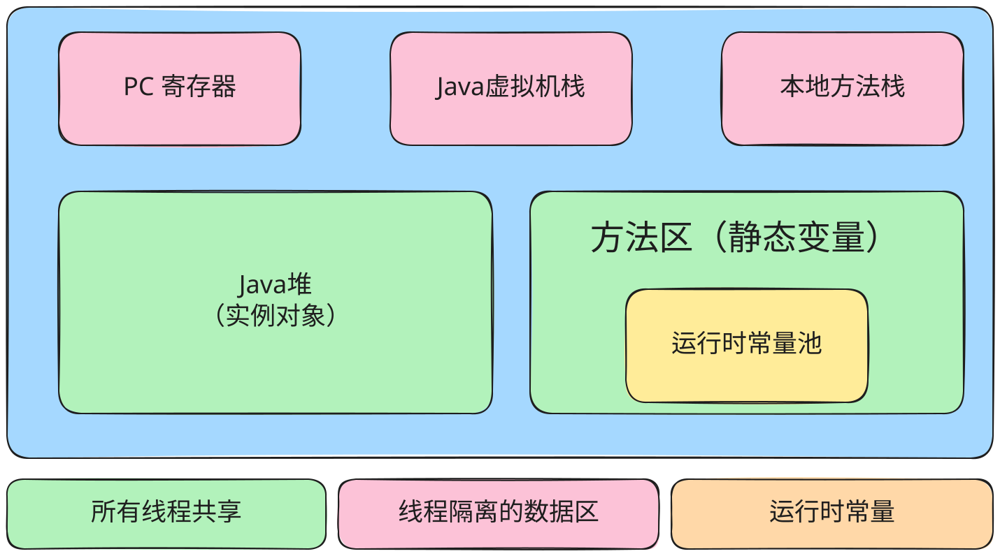

## Java 内存

### 堆区

1. 存储的全部的都是对象，每一个对象都包含一个与之对应的 class 信息（目的是为了得到操作指令）
2. jvm 只有一个堆区，被所有线程共享
3. 堆中只存放对象本身，不存放基本类型和对象引用

### 栈区

1. 每个线程包含一个栈区
2. 栈中只保存基础数据类型和对象的引用
3. 每个栈中的数据都是私有的，其他栈不能够访问
4. 栈分为三部分：
   1. 基本类型变量区、执行环境上下文、操作指令区

### 方法区（静态区）

1. 和堆一样，被所有线程共享
2. 方法区中包含的是整个程序永远唯一的元素，比如所有的 class 和 static 变量
3. 类中的方法是存放在方法区中的，无论是静态方法，还是非静态方法。所有的实例对象共享同一份类内方法。
